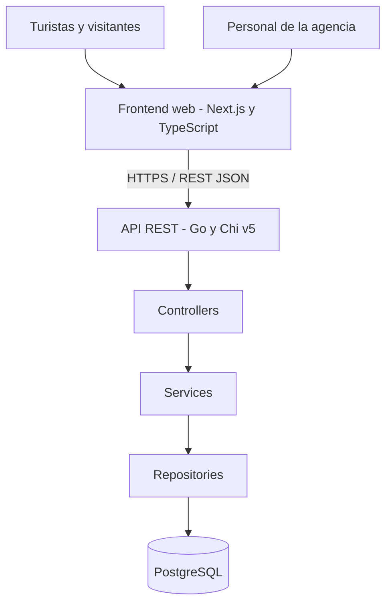
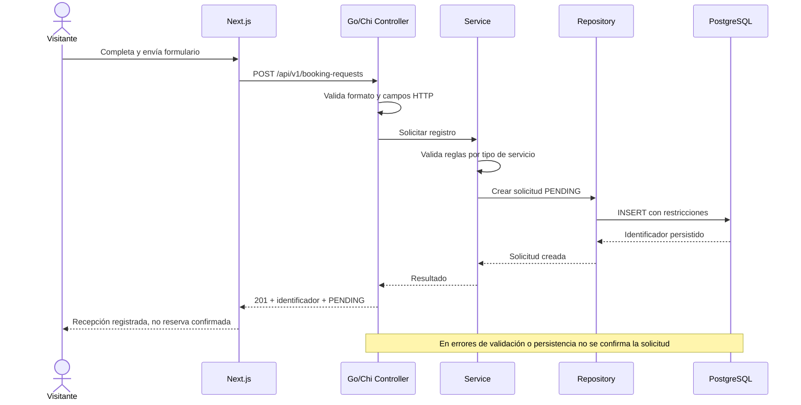
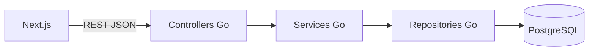
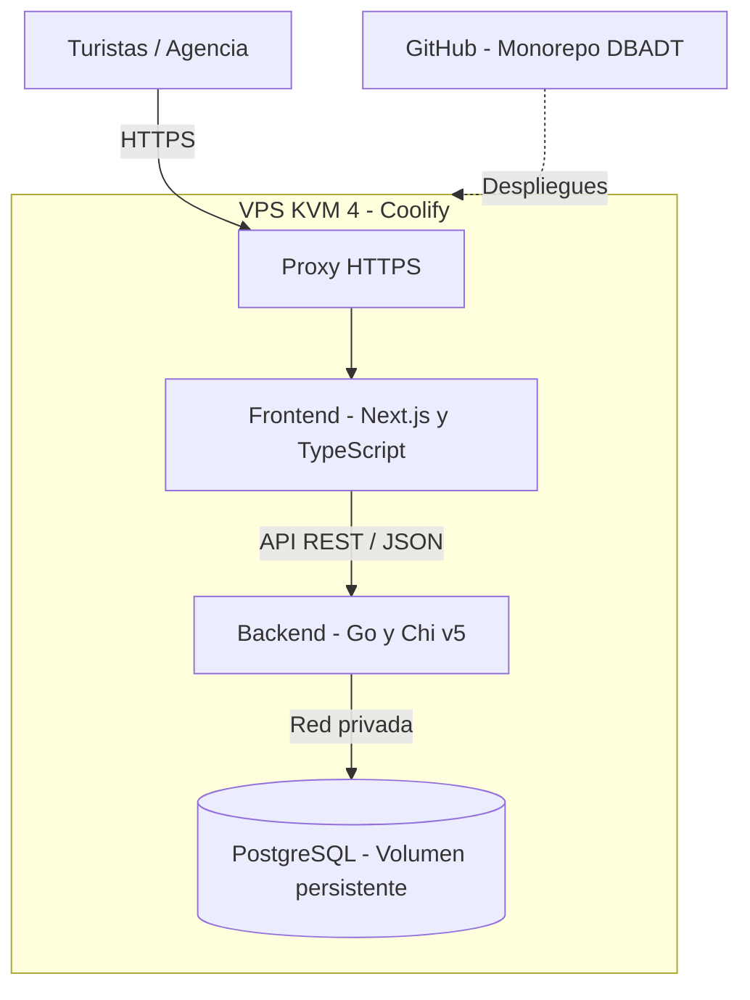
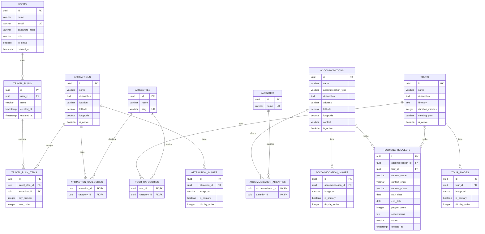

# Descubre Barquisimeto — Agencia Digital de Turismo

## 0. Ficha del proyecto

**0.1. Nombre completo:** Hernan Perez

**0.2. Título del proyecto:** Descubre Barquisimeto — Agencia Digital de Turismo

**0.3. Descripción breve:**

**Descubre Barquisimeto** es una plataforma web de turismo orientada a promover los atractivos culturales, históricos, religiosos, deportivos, gastronómicos y recreativos de Barquisimeto y sus alrededores, en Venezuela. Permite explorar destinos turísticos, consultar alojamientos, descubrir tours y realizar solicitudes de reserva mediante una experiencia digital moderna e interactiva.

El desarrollo está previsto con **Next.js y TypeScript** para el frontend, **Go (Golang) con Chi v5** para el backend y **PostgreSQL** como base de datos, utilizando una arquitectura por capas para facilitar el mantenimiento, las pruebas y la evolución del sistema.

**0.4. URL del proyecto:** https://github.com/Hernanmckool/AI4Devs-finalproject-DBADT

**0.5. URL del repositorio:** https://github.com/Hernanmckool/AI4Devs-finalproject-DBADT

> **Estado del proyecto:** Entrega 1 — Documentación técnica. La aplicación todavía no está implementada ni desplegada; las URL anteriores apuntan al repositorio de código.

### 0.6. Documentación del proyecto

Este README presenta la definición del producto, la arquitectura, el modelo de datos, el contrato REST, las historias de usuario y los tickets representativos. La información de diseño aprobada se distingue de los mecanismos todavía propuestos y de la implementación futura.

| Documento | Contenido |
|---|---|
| [`prompts.md`](prompts.md) | Prompts de diseño y planificación del proyecto. |
| [`docs/README.md`](docs/README.md) | Índice de la documentación técnica y decisiones pendientes. |
| [`docs/product/prd.md`](docs/product/prd.md) | PRD. Flujos de negocio en [`business-flows.md`](docs/product/business-flows.md) y diseño UX en [`ux-design.md`](docs/product/ux-design.md). |
| [`docs/architecture/architecture.md`](docs/architecture/architecture.md) | Arquitectura. ADR en el [índice de decisiones](docs/architecture/decisions/README.md); despliegue, seguridad y pruebas en [`deployment.md`](docs/architecture/deployment.md), [`security.md`](docs/architecture/security.md) y [`testing-strategy.md`](docs/architecture/testing-strategy.md). |
| [`docs/data/data-model.md`](docs/data/data-model.md) | Diccionario completo de las 15 tablas, restricciones e índices. |
| [`docs/api/openapi.yaml`](docs/api/openapi.yaml) | Contrato OpenAPI 3.0.3 canónico. |
| [`docs/user-stories/HU001.md`](docs/user-stories/HU001.md) | Historia HU-001; también [`HU002.md`](docs/user-stories/HU002.md), [`HU003.md`](docs/user-stories/HU003.md) y [`validation-report.md`](docs/user-stories/validation-report.md), con criterios Gherkin y validación. |
| [`docs/delivery/tickets/README.md`](docs/delivery/tickets/README.md) | Índice de tickets; proceso previsto de Pull Requests en [`pr-process.md`](docs/delivery/pull-requests/pr-process.md). |
| [`docs/ai/traceability.md`](docs/ai/traceability.md) | Trazabilidad entre los prompts y los documentos generados. |

## 1. Descripción general del producto

### 1.1. Objetivo

#### Propósito del producto

Desarrollar una plataforma digital de turismo dedicada a Barquisimeto y sus alrededores, que centralice y promueva sus principales atractivos turísticos, culturales, históricos, religiosos, deportivos y gastronómicos. La plataforma permitirá a los visitantes descubrir lugares de interés, explorar opciones de alojamiento, conocer tours y experiencias guiadas, y realizar solicitudes de reserva, ofreciendo un espacio integral para conocer y planificar una visita a la región.

#### Qué valor aporta

Ofrecer a los visitantes una experiencia digital centralizada, intuitiva y accesible para descubrir y organizar actividades turísticas en Barquisimeto, facilitando el acceso a información sobre destinos, alojamientos y experiencias. Al mismo tiempo, brindar mayor visibilidad a los prestadores de servicios turísticos de la región y facilitar la conexión con potenciales clientes.

#### Qué soluciona

Soluciona la dispersión y dificultad de acceso a información turística de Barquisimeto y sus alrededores, donde los visitantes deben consultar múltiples fuentes para conocer destinos, encontrar alojamientos y descubrir actividades. Además, simplifica el proceso de planificación de viajes y solicitudes de reserva, facilitando la conexión entre los turistas y los prestadores de servicios de la región.

#### Para quién

La plataforma está dirigida a turistas nacionales e internacionales, visitantes y residentes interesados en descubrir y disfrutar los atractivos de Barquisimeto y sus alrededores. También está orientada a agencias de turismo, hoteles, posadas, operadores turísticos y prestadores de servicios locales que buscan promocionar sus ofertas, ampliar su alcance y conectar con potenciales clientes.

**Perfiles y necesidades identificadas**

| Perfil | Necesidad principal | Acceso y alcance |
|---|---|---|
| Visitante anónimo | Conocer lugares, alojamientos, tours y solicitar una reserva | Consulta pública; puede enviar solicitudes sin iniciar sesión. |
| Turista registrado (`TOURIST`) | Guardar y recuperar recorridos personalizados | Acceso a las capacidades públicas y a sus propios planes; la autenticación se definirá técnicamente más adelante. |
| Personal de la agencia (`ADMIN`) | Revisar y resolver solicitudes de reserva | Acceso autenticado a funciones administrativas y cambios de estado autorizados. |
| Prestadores turísticos | Dar visibilidad a sus alojamientos y experiencias mediante la agencia | **Beneficiarios indirectos**: no existe un rol ni un portal de autogestión de prestadores aprobado en el MVP. |

**Objetivos de valor (cualitativos, sin métricas inventadas):** reunir información turística dispersa, reducir pasos para conocer y solicitar experiencias y facilitar la gestión interna de las solicitudes. No existe una línea base de visitantes, conversión o reservas; los indicadores cuantitativos se definirán cuando haya datos medibles.

### 1.2. Características y funcionalidades

#### F01 — Exploración de Atractivos Turísticos

- Catálogo con los principales atractivos de Barquisimeto y sus alrededores.
- Clasificación por cultura, historia, religión, deportes, gastronomía, naturaleza y entretenimiento.
- Búsqueda por nombre y filtros por categorías e intereses.
- Fichas con fotografías, descripciones, ubicación e información relevante.
- Navegación para facilitar el descubrimiento de destinos.

#### F02 — Catálogo de Hoteles, Posadas y Alojamientos

- Directorio de hoteles, posadas y otras alternativas de hospedaje.
- Búsqueda y filtros por ubicación, tipo de alojamiento y servicios o características.
- Fichas con fotografías, descripción, ubicación, servicios e información de contacto.
- Información sobre instalaciones, comodidades y características de cada establecimiento.
- Posibilidad de iniciar una solicitud de reserva sin pago en línea ni verificación automática de disponibilidad.

#### F03 — Tours y Experiencias Turísticas

- Catálogo de tours, excursiones y experiencias turísticas de la región.
- Clasificación por categorías culturales, históricas, religiosas, gastronómicas, naturales y de aventura.
- Información sobre itinerario descriptivo, duración, lugares de interés y actividades previstas.
- Fichas con fotografías, punto de encuentro y datos relevantes.
- Búsqueda y filtros por tipo, ubicación y duración.
- Solicitudes de reserva, sin procesar pagos ni consultar disponibilidad en tiempo real en esta etapa.

#### F04 — Solicitudes de Reserva

- Formulario para expresar interés en reservar un alojamiento o tour.
- Registro de fechas, cantidad de personas, datos de contacto y observaciones opcionales.
- Validación de datos obligatorios y coherencia de fechas.
- Confirmación de recepción con número de referencia.
- Estados de solicitud: `PENDING`, `CONFIRMED` y `REJECTED`.
- La confirmación de disponibilidad corresponde a la agencia; no hay pagos en línea ni confirmación automática de reservas.

#### F05 — Gestión de Solicitudes por la Agencia

- Panel administrativo de acceso restringido al personal autorizado.
- Consulta de solicitudes por visitante, servicio, fechas, cantidad de personas y estado.
- Filtros por servicio, estado y fechas.
- Detalle de datos de contacto y observaciones.
- Confirmación o rechazo de solicitudes pendientes.
- Control de acceso y seguimiento del estado de cada solicitud.

#### F06 — Mapa Turístico Interactivo

- Mapa de Barquisimeto y alrededores.
- Marcadores para monumentos, sitios históricos y culturales, espacios deportivos, parques, hoteles y posadas.
- Filtros de visualización por categoría.
- Información contextual de cada ubicación: nombre, fotografía y descripción breve.
- Acceso desde el mapa a la ficha correspondiente del catálogo.
- Interacción mediante zoom y desplazamiento.

#### F07 — Planificador Personalizado de Recorridos

- Creación de itinerarios personales a partir de atractivos del catálogo.
- Organización de visitas por días y orden de recorrido.
- Visualización del nombre, descripción e información relevante de cada lugar.
- Posibilidad de agregar, quitar y reordenar atractivos.
- Resumen del recorrido organizado.
- **Cuenta de turista obligatoria** para guardar y recuperar recorridos en distintos accesos.
- Se permite repetir un atractivo en diferentes posiciones o días.
- No incluye, en esta etapa, generación automática de itinerarios mediante IA ni optimización de rutas.

**Alcance aprobado, secuenciación y dependencias**

Las siete funcionalidades anteriores constituyen el **alcance funcional definido del producto**, pero no implican que todas deban estar desarrolladas en la segunda entrega. Para la documentación académica se seleccionaron **tres historias representativas**: HU-001 (F01), HU-002 (F04) y HU-003 (F05). La prioridad definitiva y la planificación por sprints **no están aprobadas**.

| Capacidad | Dependencia funcional relevante | Estado |
|---|---|---|
| F01 — Atractivos | Datos y categorías de atractivos | Definida; HU-001 documentada |
| F02 — Alojamientos | Fichas y servicios de alojamientos | Definida; fuera de las 3 HU representativas |
| F03 — Tours | Fichas y descripción textual de itinerarios | Definida; fuera de las 3 HU representativas |
| F04 — Solicitudes | Datos de un alojamiento **o** tour activo; datos de contacto | Definida; HU-002 documentada |
| F05 — Administración | Solicitudes F04 y autorización `ADMIN` | Definida; HU-003 documentada |
| F06 — Mapa | Coordenadas geográficas y fichas del catálogo | Definida; implementación aún pendiente |
| F07 — Recorridos | Atractivos F01 y cuenta del turista para persistirlos | Definida; implementación aún pendiente |

**Límites del MVP:** no se incluye cobro en línea, integración obligatoria con operadores, comprobación automática de disponibilidad, generación de itinerarios con IA ni optimización de rutas. La atención posterior de una solicitud corresponde a la agencia. **Roadmap por versiones y prioridades MoSCoW:** pendiente de validación; no se atribuye una priorización que aún no se decidió.

**Riesgos y supuestos de negocio**

| Riesgo o dependencia | Consecuencia | Tratamiento previsto |
|---|---|---|
| Información turística desactualizada | Consultas con datos incorrectos | Curación editorial y control de contenido por la agencia; frecuencia pendiente. |
| El visitante interpreta `PENDING` como reserva confirmada | Expectativas equivocadas | Mensaje explícito de **recepción de solicitud**, sin garantía de disponibilidad. |
| Falta de definición del mecanismo de autenticación | Bloqueo del acceso a planes guardados y administración | Resolver antes de implementar F05/F07, sin inventar una tecnología. |
| Funcionalidades F01–F07 tratadas como implementación simultánea | Riesgo de alcance excesivo | Ejecutar incrementalmente; la prioridad se decidirá durante el refinamiento. |

**Decisiones pendientes de producto:** priorización del desarrollo, criterios para mantener actualizadas las fichas turísticas y detalles de interacción del panel. En las solicitudes de reserva también siguen pendientes el formato del número de referencia, el comportamiento ante fechas pasadas y el mecanismo de comunicación posterior con el visitante; no se asume ningún mecanismo de notificación. Ninguna de esas decisiones altera las siete capacidades acordadas.

### 1.3. Diseño y experiencia de usuario

**Descubre Barquisimeto** ofrecerá una experiencia web moderna, visual e intuitiva, enfocada en facilitar el descubrimiento de destinos turísticos y la planificación de visitas. El diseño será adaptable a dispositivos móviles, tablets y computadoras, priorizando la navegación sencilla y el contenido visual de la región.

**Experiencia del visitante**

- **Página de inicio:** imágenes destacadas de la región, atractivos recomendados y accesos a alojamientos, tours y experiencias.
- **Exploración turística:** navegación por categorías, búsquedas y filtros para descubrir destinos.
- **Detalle de destinos:** fichas con fotografías, descripciones y ubicaciones.
- **Alojamientos y tours:** catálogos con información para comparar opciones y conocer experiencias disponibles.
- **Solicitud de reserva:** formulario de fechas, personas y contacto, con confirmación de recepción.
- **Mapa y planificador:** exploración geográfica y organización de recorridos personalizados; para guardar recorridos se requiere una cuenta de turista.

**Experiencia de la agencia**

- Panel administrativo de acceso autorizado para consultar, filtrar y gestionar las solicitudes de reserva recibidas.

**Documentación visual**

- Durante el desarrollo se incorporarán capturas de pantalla o video que permitan observar los principales flujos de uso de la plataforma.

**Recorridos funcionales propuestos para el diseño de pantallas**

| Flujo | Recorrido y resultado | Condiciones y excepciones |
|---|---|---|
| Descubrir un atractivo | Inicio/catálogo → búsqueda o filtro → ficha y ubicación | Consulta anónima; sin resultados muestra estado vacío; error de API genera aviso recuperable. |
| Solicitar alojamiento o tour | Catálogo → ficha → formulario → validaciones → confirmación de **recepción** con referencia | Un solo servicio por solicitud; fechas según tipo; respuesta en `PENDING`; no hay pago ni disponibilidad garantizada. |
| Resolver solicitud | Acceso `ADMIN` → consulta de pendientes → detalle → confirmar o rechazar | Solo transición desde `PENDING`; intentos repetidos o simultáneos se rechazan con conflicto. |
| Guardar un recorrido | Catálogo/mapa → selección de atractivos → organización por día y orden → guardar | Requiere cuenta `TOURIST`; sin autenticación solo puede consultarse la información pública. |

**Vistas previstas:** inicio, listados y fichas de atractivos/alojamientos/tours, mapa turístico, formulario de solicitudes, acceso a recorridos personales y área administrativa. Esta organización es una **propuesta de experiencia**, no un diseño visual ya construido ni una definición definitiva del menú.

**Componentes reutilizables sugeridos:** tarjetas de atractivo/alojamiento/tour, controles de búsqueda y filtros, paginación, galería de imágenes, estados de carga/error/vacío, campos de formulario con validación y presentación de marcadores del mapa. Son propuestas de UX a validar durante el diseño; no hay biblioteca de componentes seleccionada.

**Estados de interfaz que deberán diseñarse y probarse:** `loading` (carga de datos), `empty` (sin resultados), `error` (fallo de comunicación), validación de campos y confirmación de recepción. Las páginas públicas deben ser utilizables sin autenticarse; la persistencia del plan y el panel administrativo exigen permisos.

**Accesibilidad a validar:** etiquetas y mensajes comprensibles, navegación con teclado, foco visible, contraste legible, textos alternativos de imágenes e indicaciones que no dependan exclusivamente del color. La referencia será WCAG aplicable, sin declarar conformidad ni pruebas realizadas en esta etapa.

**Material visual:** los wireframes, capturas o video de la aplicación se incorporarán cuando exista interfaz implementada; no se presentan prototipos inexistentes.

### 1.4. Instrucciones de instalación

**Estado: Pendiente de implementación.**

El proyecto utilizará las siguientes tecnologías:

- **Frontend:** Next.js + TypeScript.
- **Backend:** Go (Golang) + Chi v5, con arquitectura por capas.
- **Base de datos:** PostgreSQL.

Las instrucciones de instalación se documentarán durante la implementación e incluirán los requisitos previos, la instalación de dependencias, las variables de entorno, la configuración de PostgreSQL, la ejecución de migraciones y datos de prueba, el inicio del frontend y backend y la verificación de pruebas.

## 2. Arquitectura del Sistema

### 2.1. Diagrama y arquitectura del sistema

**Patrón general:** arquitectura cliente-servidor, con frontend y backend independientes y un backend organizado en capas **Controller → Service → Repository**.



**Justificación de la arquitectura**

- La separación entre interfaz web, lógica de negocio y persistencia facilita el mantenimiento y la evolución del producto.
- Los controladores administran las solicitudes y respuestas HTTP; los servicios concentran las reglas de negocio y los repositorios gestionan el acceso a PostgreSQL.
- Next.js permite desarrollar una experiencia web adaptable a distintos dispositivos y Go + Chi v5 ofrece una API REST independiente.

**Ventajas**

- Separación de responsabilidades entre presentación, negocio y datos.
- Posibilidad de probar los servicios de manera aislada.
- Mantenibilidad y extensibilidad de funcionalidades sin acoplar la lógica de negocio a HTTP o SQL.
- Desarrollo y despliegue independientes de frontend y backend.

**Limitaciones**

1. **Mayor coordinación:** frontend y backend requieren contratos API claros y consistentes para garantizar una comunicación correcta entre ambos componentes.
2. **Mantenimiento de dos entornos:** Go y Next.js tienen procesos de compilación, ejecución y despliegue diferentes que deben administrarse de manera independiente.

**Secuencia de referencia — envío de solicitud de reserva (diseño, no ejecución)**



**Riesgos arquitectónicos reconocidos:** frontend y backend necesitan un contrato coherente; un solo VPS concentra riesgo de disponibilidad; la autenticación es una decisión técnica todavía abierta; y la forma de comunicación entre Next.js y Go no está definida. Hay dos alternativas pendientes: API accesible desde el navegador mediante HTTPS, o API privada consumida a través del servidor Next.js. Los diagramas no representan una elección entre ellas. Las reglas de permisos, transiciones de estado y consistencia se ejecutan en Go/PostgreSQL, no exclusivamente en el navegador.

**Registro resumido de decisiones (formato ADR documental)**

| Decisión | Contexto y decisión aprobada | Consecuencias y límites | Alternativas / estado |
|---|---|---|---|
| ADR-D01 — Stack | Interfaz Next.js/TypeScript y API Go/Chi v5, conectados mediante REST/JSON | Separación de frontend/backend y testing; requiere coordinar dos ciclos de compilación y despliegue | No se reconstruye una comparación histórica formal de alternativas. **Aprobada**. |
| ADR-D02 — Estructura del backend | Capas `Controller → Service → Repository` con PostgreSQL | Responsabilidades diferenciadas; riesgo de sobrefragmentar servicios si se aplican capas sin criterio | Microservicios y otras arquitecturas no forman parte del diseño adoptado. **Aprobada**. |
| ADR-D03 — Infraestructura | Docker/Coolify en VPS KVM 4 propio | Costos y operación centralizados; punto único de falla y responsabilidad de backups | No se afirma haber realizado pruebas comparativas de proveedores. **Aprobada y no desplegada**. |
| ADR-D04 — Organización del repositorio | Monorepo con `frontend/`, `backend/`, `database/`, `tests/e2e/` y `docs/` (ver 2.3) | Cambios de contrato revisables en un único PR; conviven dos ecosistemas de dependencias | Registro de una decisión ya aprobada; sin comparación histórica de alternativas. **Aprobada**. |
| ADR-P01 — Autenticación | Existen usuarios `TOURIST` y `ADMIN` con accesos diferentes | Su mecanismo definirá sesiones, tokens/cookies y protecciones relacionadas | **Pendiente**: no se selecciona JWT, cookie ni proveedor. |

Estas fichas resumen decisiones existentes para revisar su impacto. No se presentan como deliberaciones históricas documentadas. Las fichas completas están en el [índice de ADR](docs/architecture/decisions/README.md).

### 2.2. Componentes principales

| Componente | Tecnología | Responsabilidad |
|---|---|---|
| **Frontend web** | Next.js + TypeScript | Presentación de destinos, alojamientos, tours, reservas, mapa, planificador y panel administrativo; consume la API mediante REST/JSON. |
| **Router y controllers** | Go + Chi v5 | Definición de rutas, lectura y validación inicial de solicitudes y construcción de respuestas HTTP. |
| **Services** | Go | Reglas de negocio: solicitudes de reserva, estados, filtros, permisos y recorridos personalizados. |
| **Repositories** | Go | Acceso a datos y consultas parametrizadas a PostgreSQL. |
| **Base de datos** | PostgreSQL | Persistencia de usuarios, categorías, atractivos, alojamientos, servicios, tours, imágenes, solicitudes y recorridos. |

La API seguirá un contrato REST/JSON. El backend se organizará bajo un enfoque por capas, sin introducir microservicios ni arquitecturas hexagonales que no hayan sido definidas para el proyecto.

**Trazabilidad entre capacidades y componentes**

| Función | Frontend Next.js | Service Go | Repository / PostgreSQL |
|---|---|---|---|
| F01 Atractivos | Catálogo, filtros y fichas | Filtrado de activos y paginación | `attractions`, categorías e imágenes |
| F02 Alojamientos | Catálogo y detalle | Reglas de consulta y activación | `accommodations`, servicios e imágenes |
| F03 Tours | Catálogo y detalle | Consultas y reglas de publicación | `tours`, categorías e imágenes |
| F04 Solicitudes | Formulario y recepción | Validación y alta `PENDING` | `booking_requests` |
| F05 Administración | Vistas de gestión | Autorización `ADMIN` y transiciones atómicas | `booking_requests` |
| F06 Mapa | Marcadores y navegación geográfica | Consulta de coordenadas autorizadas | Datos geográficos de catálogos |
| F07 Recorridos | Editor de días y orden | Permisos de propietario y reglas del plan | `travel_plans`, `travel_plan_items` |

**Dependencias entre capas (diseño)**



El controlador valida el contrato HTTP; el servicio aplica reglas y autorización; el repositorio encapsula consultas y transacciones. La capa de presentación puede validar para ayudar al usuario, pero **no sustituye** las verificaciones de seguridad ni las reglas de negocio del servidor. No existen llamadas directas desde el navegador a PostgreSQL.

### 2.3. Estructura de carpetas y patrones arquitectónicos

Se utilizará un único repositorio (**monorepo**) con separación entre frontend, backend, base de datos, documentación y pruebas. La estructura prevista es:

```text
AI4Devs-finalproject-DBADT/
├── frontend/
│   ├── public/
│   ├── src/
│   │   ├── app/
│   │   ├── components/
│   │   ├── hooks/
│   │   ├── lib/
│   │   ├── services/
│   │   └── types/
│   └── package.json
├── backend/
│   ├── cmd/api/
│   ├── internal/
│   │   ├── controllers/
│   │   ├── services/
│   │   ├── repositories/
│   │   ├── models/
│   │   ├── middleware/
│   │   ├── config/
│   │   └── dto/
│   ├── tests/integration/
│   └── go.mod
├── database/
│   ├── migrations/
│   └── seeds/
├── tests/e2e/
├── docs/
├── README.md
└── prompts.md
```

**Patrones utilizados**

- **Layered Architecture:** organización de la lógica backend por capas Controller, Service y Repository.
- **Service Layer:** concentración de la lógica de negocio fuera de los controladores HTTP.
- **Repository:** encapsulación del acceso a PostgreSQL.
- **Monorepo:** gestión conjunta de los componentes en un repositorio, manteniendo sus dependencias y procesos de ejecución separados.

**Organización de las pruebas**

- Pruebas unitarias de Go en archivos `*_test.go` junto al código correspondiente.
- Pruebas de integración backend y PostgreSQL en `backend/tests/integration/`.
- Pruebas de extremo a extremo en `tests/e2e/`.
- Pruebas funcionales HTTP para validar contratos y respuestas de la API.

La estructura es la **organización planificada**: su presencia en este documento no implica que todos los directorios o archivos ya estén creados.

**Desarrollo asistido por IA (propuesto):** en las siguientes entregas se evaluará el uso de instrucciones persistentes para agentes, subagentes especializados, skills, hooks, especificaciones OpenSpec y controles automáticos. Ninguno de estos mecanismos está instalado o implementado en esta entrega. Sus responsabilidades, límites y puntos de aprobación humana se documentan en [`docs/ai/sdd-harness.md`](docs/ai/sdd-harness.md).

### 2.4. Infraestructura y despliegue

#### Infraestructura autohospedada con Coolify

La plataforma se desplegará en un servidor VPS administrado mediante **Coolify**, centralizando la ejecución del frontend, backend y base de datos en una misma infraestructura.

**Servicios principales**

| Componente | Tecnología | Descripción |
|---|---|---|
| Servidor | VPS KVM 4 | Infraestructura de alojamiento |
| Gestión de despliegues | Coolify | Administración de aplicaciones y contenedores |
| Frontend | Next.js + TypeScript | Aplicación web |
| Backend | Go + Chi v5 | API REST y lógica de negocio |
| Base de datos | PostgreSQL | Persistencia de información |
| Código fuente | GitHub | Repositorio monorepo y control de versiones |
| Contenedores | Docker | Aislamiento y ejecución de aplicaciones |

**Especificaciones del servidor**

| Recurso | Capacidad |
|---|---|
| CPU | 4 vCPU |
| RAM | 16 GB |
| Almacenamiento | 200 GB NVMe |
| Transferencia | 16 TB |

**Arquitectura de despliegue**



El diagrama no decide la exposición de la API. Sigue pendiente elegir entre publicarla en el proxy para que el navegador la consuma mediante HTTPS, o mantenerla privada y consumida solo por el servidor Next.js.

**Proceso de despliegue propuesto**

1. **Control de versiones:** el código fuente se administra en GitHub, dentro de un único repositorio.
2. **Integración con Coolify:** se configura el repositorio y los directorios correspondientes al frontend y backend.
3. **Construcción:** Coolify construye las aplicaciones a partir de sus respectivas configuraciones de Docker.
4. **Despliegue:** los contenedores del frontend y backend se publican en el VPS.
5. **Persistencia:** PostgreSQL se ejecuta con almacenamiento persistente y conectividad privada con el backend.
6. **Verificación:** se comprueba que las aplicaciones estén disponibles y puedan comunicarse correctamente.

**Estrategia de despliegue**

- Despliegue independiente del frontend y backend.
- Gestión de variables de entorno desde Coolify, sin almacenar credenciales en Git.
- HTTPS para las conexiones públicas.
- Health checks para verificar el estado de los servicios.
- Versionado de imágenes para identificar las versiones desplegadas.
- Procedimiento de recuperación o restauración de una versión anterior, pendiente de definir.

**Monitoreo y observabilidad**

- Logs de aplicación para consultar errores y eventos del frontend y backend.
- Estado de los contenedores desde Coolify.
- Verificación de disponibilidad de los servicios.
- Monitoreo de CPU, RAM y almacenamiento del VPS.

**Respaldos**

**Requisito aprobado:** PostgreSQL debe disponer de respaldos almacenados **fuera del VPS principal**. El mecanismo, el proveedor, la frecuencia, la retención y el procedimiento de recuperación están pendientes y se definirán antes del despliegue productivo. No se selecciona ni contrata ningún servicio externo.

> **Estado:** infraestructura aprobada y planificada. La instalación de Coolify, los despliegues y las verificaciones operativas todavía no se declaran realizados.

**Riesgos operativos y decisiones de despliegue pendientes**

| Aspecto | Riesgo en VPS único | Medida prevista / decisión pendiente |
|---|---|---|
| Disponibilidad | Falla del host afecta interfaz, API y base | Health checks y procedimiento de recuperación; objetivos RTO/RPO pendientes. |
| Datos | Fallo del disco o borrado accidental | Backups restaurables fuera del VPS principal (requisito aprobado); mecanismo, proveedor, frecuencia, retención y prueba de restauración pendientes. |
| Capacidad | Procesos compiten por CPU/RAM/almacenamiento | Métricas y pruebas de carga antes de ajustar recursos. |
| Actualización | Un despliegue defectuoso interrumpe el servicio | Versionado de artefactos y rollback probado antes de producción. |
| Secretos | Filtración por repositorio o logs | Variables gestionadas en Coolify y accesos mínimos. |

**Separación prevista por ambiente:** las configuraciones, credenciales y datos de desarrollo/pruebas no se reutilizarán en producción. La topología exacta de entornos, horarios de backup, dominios y política de rollback **no han sido aprobados aún**. Ninguna de estas medidas se declara operativa.

### 2.5. Seguridad

La plataforma **Descubre Barquisimeto** contemplará medidas de seguridad para proteger los datos de los visitantes, controlar las operaciones administrativas y garantizar la integridad de la información. Las prácticas siguientes están **previstas**, no se presentan como implementadas.

#### Seguridad de la aplicación

**1. Autenticación y autorización**

- Acceso administrativo protegido mediante autenticación del personal de la agencia.
- Control de autorización para restringir la consulta y modificación de solicitudes de reserva.
- Gestión segura de sesiones.
- Protección de endpoints administrativos mediante verificación de identidad y permisos en Go.
- Los usuarios registrados públicamente obtendrán el rol `TOURIST`; las cuentas `ADMIN` se crearán mediante un procedimiento administrativo autorizado.

**2. Validación de entradas y protección de API**

- Validación en Go de campos obligatorios, formatos, longitudes y reglas de negocio.
- Consultas SQL parametrizadas para reducir el riesgo de inyección SQL.
- Rate limiting frente a solicitudes excesivas y abuso.
- Límites de tamaño y tiempo de petición para reducir el consumo excesivo de recursos.
- Manejo controlado de errores que evite revelar información interna.

**3. Protección del frontend**

- Prevención de XSS mediante tratamiento seguro del contenido dinámico.
- Protección CSRF en operaciones que utilicen autenticación basada en cookies, si se adopta dicho mecanismo.
- Configuración de CORS restringida a orígenes autorizados cuando corresponda.
- Cabeceras HTTP de seguridad apropiadas.

#### Protección de datos

**1. Información personal de visitantes**

- Recopilación mínima de información necesaria para gestionar solicitudes de reserva.
- Acceso restringido a los datos de contacto.
- Prevención del registro innecesario de información personal en logs.
- Uso de datos sintéticos en entornos de desarrollo y pruebas.

**2. Seguridad de PostgreSQL**

- Comunicación privada entre backend y base de datos.
- Credenciales protegidas, fuera del repositorio.
- Permisos de acceso limitados según las necesidades de cada componente.
- Claves foráneas y restricciones de integridad.
- Respaldos almacenados fuera del VPS principal (requisito aprobado); mecanismo y recuperación por definir.

#### Seguridad de infraestructura — Coolify

**1. Comunicaciones y credenciales**

- HTTPS con certificados TLS para las conexiones públicas.
- Variables de entorno administradas desde Coolify.
- Servicios aislados en contenedores Docker.
- PostgreSQL sin exposición pública, accesible solo desde componentes autorizados.

**2. Seguridad de despliegues**

- Imágenes base mantenidas y actualizadas.
- Revisión de dependencias de Go y Next.js.
- Control de acceso al repositorio y a Coolify.
- Health checks de los servicios.

#### Monitoreo y auditoría

- Logs estructurados para errores y eventos relevantes.
- Auditoría de accesos administrativos y operaciones sobre solicitudes.
- Monitoreo de disponibilidad de frontend, backend y PostgreSQL.
- Identificación de intentos reiterados de autenticación fallida y otros eventos sospechosos.
- Revisión de incidencias de seguridad.

#### Implementación técnica prevista

Durante las siguientes entregas se incorporarán ejemplos reales de **validación de solicitudes en Go**, **rate limiting compatible con Chi** y **autorización administrativa**. No se incluyen fragmentos ficticios presentados como código ya implementado.

**Matriz de permisos por perfil (requisito funcional, mecanismo pendiente)**

| Operación | Visitante | `TOURIST` | `ADMIN` |
|---|---|---|---|
| Explorar atractivos, alojamientos y tours | Sí | Sí | Sí |
| Enviar solicitud de reserva | Sí | Sí | Sí |
| Guardar/editar sus propios recorridos | No | Sí | No definido como función del administrador |
| Consultar y resolver solicitudes de terceros | No | No | Sí |
| Crear cuentas administrativas | No | No | Solo procedimiento autorizado; flujo técnico pendiente |

Los controles de seguridad, la comparación de alternativas de autenticación y la matriz completa de riesgos están desarrollados en [`docs/architecture/security.md`](docs/architecture/security.md). El mecanismo de autenticación sigue sin definirse.

### 2.6. Tests

El proyecto seguirá **TDD (RED → GREEN → REFACTOR)**, derivando pruebas de criterios de aceptación y de especificaciones funcionales aprobadas. No hay pruebas de código ejecutadas ni resultados de cobertura en esta primera entrega.

| Nivel | Alcance | Herramientas previstas |
|---|---|---|
| Unitario backend | Reglas de negocio, fechas, permisos y transiciones | Go `testing`, `go test` |
| HTTP e integración | Contratos API, persistencia y restricciones PostgreSQL | `net/http/httptest`, PostgreSQL aislado |
| Unitario frontend | Componentes, interacción y estados de carga/error | Vitest, React Testing Library |
| End-to-end | Exploración, solicitud y gestión administrativa | Playwright |
| Rendimiento | Concurrencia, tiempos de respuesta, recursos | k6 |
| Seguridad | Validaciones, permisos y vulnerabilidades | Tests de seguridad, `govulncheck` |

**Objetivo de cobertura aprobado:** 80 % del código de servicios de negocio. Se exige al menos un flujo E2E del proceso principal durante la entrega de código correspondiente.

**SDD y guardrails (propuestos):** se evaluará OpenSpec para versionar requisitos y escenarios verificables; la implementación futura seguirá la secuencia especificación revisada → aprobación humana → test RED → GREEN → REFACTOR → controles automáticos → revisión independiente. OpenSpec, los hooks, la CI y los agentes no están instalados ni se han ejecutado como controles del software.

La estrategia detallada y la matriz requisito → prueba están en [`docs/architecture/testing-strategy.md`](docs/architecture/testing-strategy.md).

## 3. Modelo de Datos

El modelo de datos planificado utilizará **PostgreSQL** e incluye **15 tablas**. El diseño responde a las funcionalidades F01–F07 y a las decisiones de negocio aprobadas.

### 3.1. Diagrama del modelo de datos



### 3.2. Entidades y reglas de integridad

El modelo relacional contiene **exactamente 15 tablas**. Las principales reglas aprobadas son:

- Usuarios `TOURIST` y `ADMIN`; correos únicos y permisos aplicados por el backend.
- Categorías compartidas por atractivos y tours mediante relaciones N:M.
- Galerías de imágenes para atractivos, alojamientos y tours, con máximo una imagen principal por entidad.
- Solicitudes de reserva asociadas **a un alojamiento o a un tour, nunca a ambos**. El estado inicial es `PENDING` y solo admite transición a `CONFIRMED` o `REJECTED` mediante una operación administrativa atómica.
- Para alojamientos, la salida debe ser posterior a la entrada; para tours se requiere solo la fecha de actividad y `end_date` es `NULL`.
- Los recorridos turísticos pertenecen a usuarios registrados y pueden repetir atractivos en posiciones distintas.
- Los elementos desactivados se excluyen de nuevas operaciones públicas cuando corresponda, preservando las referencias históricas.

**Diccionario de datos consolidado (diseño, no DDL ejecutado)**

| Tabla | PK / claves de relación | Atributos representativos y tipos conceptuales |
|---|---|---|
| `users` | `id` UUID | `email` VARCHAR único, `password_hash` VARCHAR, `role` VARCHAR, `is_active` BOOLEAN |
| `categories` | `id` UUID | `name` VARCHAR, `slug` VARCHAR único |
| `attractions` | `id` UUID | `name` VARCHAR, `description` TEXT, `latitude/longitude` DECIMAL, `is_active` BOOLEAN |
| `attraction_categories` | (`attraction_id`, `category_id`) UUID | Dos FK; combinación única |
| `attraction_images` | `id` UUID, FK `attraction_id` | `image_url` VARCHAR, `is_primary` BOOLEAN, `display_order` INTEGER |
| `accommodations` | `id` UUID | `accommodation_type` VARCHAR, `address` VARCHAR, `contact` VARCHAR, `is_active` BOOLEAN |
| `amenities` | `id` UUID | `name` VARCHAR único |
| `accommodation_amenities` | (`accommodation_id`, `amenity_id`) UUID | Dos FK; combinación única |
| `accommodation_images` | `id` UUID, FK `accommodation_id` | `image_url` VARCHAR, `is_primary` BOOLEAN, `display_order` INTEGER |
| `tours` | `id` UUID | `itinerary` TEXT, `duration_minutes` INTEGER, `meeting_point` VARCHAR |
| `tour_categories` | (`tour_id`, `category_id`) UUID | Dos FK; combinación única |
| `tour_images` | `id` UUID, FK `tour_id` | `image_url` VARCHAR, `is_primary` BOOLEAN, `display_order` INTEGER |
| `booking_requests` | `id` UUID, FK opcionales a alojamiento/tour | `contact_email` VARCHAR, `start_date/end_date` DATE, `status` VARCHAR |
| `travel_plans` | `id` UUID, FK `user_id` | `name` VARCHAR, `created_at/updated_at` TIMESTAMP |
| `travel_plan_items` | `id` UUID, FK `travel_plan_id` y `attraction_id` | `day_number/item_order` INTEGER |

La cardinalidad y el resto de campos se describen en el DER y en las fichas de las 15 entidades de [`docs/data/data-model.md`](docs/data/data-model.md#3-diccionario-de-datos). Los tamaños de `VARCHAR`, decisiones de `TIMESTAMP` con zona horaria y valores por defecto físicos se concretarán al escribir migraciones; no se inventan DDL o índices ya aplicados.

**Migraciones previstas:** versionado incremental de cambios de esquema, orden de creación según FK, migraciones reversibles cuando sea seguro y verificación en base de pruebas independiente. Antes de ejecutar una migración destructiva habrá evaluación de impacto y aprobación; no existen migraciones ejecutadas en la primera entrega.

## 4. Especificación de la API

API **REST/JSON** desarrollada en **Go (Golang) con Chi v5**, bajo el prefijo `/api/v1`. Permite consultar atractivos turísticos, registrar solicitudes de reserva y gestionar su estado desde el panel administrativo.

**Convenciones generales:**

- **Autenticación:** los endpoints públicos de consulta y solicitud de reserva no requieren iniciar sesión. Las operaciones administrativas requieren un usuario autenticado con rol `ADMIN`. El mecanismo definitivo de autenticación está pendiente de definición; se representa provisionalmente mediante Bearer Token.
- **Errores:** respuestas JSON con los campos `error`, `message` y `details` cuando corresponda. Se utilizan códigos HTTP `400` (validación), `401` (no autenticado), `403` (sin permisos), `404` (recurso inexistente), `409` (conflicto) y `500` (error interno).
- **Validación:** el backend verifica formatos, campos obligatorios, reglas de negocio y permisos antes de persistir información.
- **Reservas:** no se procesan pagos ni se confirma disponibilidad en tiempo real. Toda solicitud nueva se registra en estado `PENDING`.
- **Seguridad:** se contemplan HTTPS, validación de entradas, control de acceso y rate limiting, de acuerdo con la sección 2.5.
- **Infraestructura prevista:** backend Go y PostgreSQL a desplegar mediante Coolify en el VPS aprobado; despliegue aún no realizado.
- **Base URL:** pendiente de despliegue y configuración del dominio.
- **Versión:** `v1`.
- **Formato:** JSON.

A continuación se resumen las **3 operaciones representativas** del flujo principal de la plataforma, especificadas mediante **OpenAPI 3.0.3**:

1. `GET /api/v1/attractions` — Consultar atractivos turísticos.
2. `POST /api/v1/booking-requests` — Registrar solicitudes de reserva.
3. `PATCH /api/v1/booking-requests/{id}/status` — Confirmar o rechazar una solicitud (solo `ADMIN`).

**Resumen de operaciones documentadas**

| Método y ruta | Acceso | Entrada | Resultado esperado | Errores representativos |
|---|---|---|---|---|
| `GET /api/v1/attractions` | Público | `q`, `category`, `page`, `limit` | `200` con colección paginada de atractivos activos | `400` parámetros inválidos, `500` error interno |
| `POST /api/v1/booking-requests` | Público | Tipo de recurso por referencia exclusiva a alojamiento o tour; contacto, fechas y participantes | `201`, identificador y `PENDING` | `400` validación, `404` recurso ausente/inactivo, `500` error interno |
| `PATCH /api/v1/booking-requests/{id}/status` | Solo `ADMIN` | UUID y nuevo estado `CONFIRMED` o `REJECTED` | `200` estado actualizado de manera atómica | `400`, `401`, `403`, `404`, `409`, `500` |

**Contrato canónico:** [`docs/api/openapi.yaml`](docs/api/openapi.yaml). Contiene las estructuras de datos, parámetros, códigos de respuesta, ejemplos y validaciones de los tres endpoints anteriores. El bloque YAML de esta sección es una copia exacta de ese archivo: ante cualquier cambio se modifica primero el archivo canónico y después se replica aquí.

El contrato de solicitud usa `oneOf` para representar que se solicita exactamente un alojamiento o un tour, y define un formato común para errores. Estas precisiones no incorporan nuevas rutas ni modifican las reglas de negocio. La documentación ampliada y el detalle de las correcciones están en [`docs/api/api-reference.md`](docs/api/api-reference.md).

**Contrato OpenAPI 3.0.3 (copia exacta de `docs/api/openapi.yaml`)**

```yaml
openapi: 3.0.3

# Fuente canónica del contrato REST API de Descubre Barquisimeto (corrección CC-6).
# README.md §4 reproduce este archivo de forma exacta; ante cualquier cambio,
# se edita este archivo y se sincroniza la copia del README.
# Origen: prompts.md §4, Prompt 1 — Diseño y documentación del contrato REST API.
# Diferencias respecto del contrato inicial del README: docs/api/api-reference.md §7.
# Estado: contrato propuesto de tres operaciones; endpoints no implementados ni desplegados.

info:
  title: Descubre Barquisimeto API
  version: 1.0.0
  description: >
    API REST para catálogo turístico y gestión de reservas.
    Documenta exclusivamente las tres operaciones aprobadas para la entrega 1.
    No incluye pagos ni disponibilidad en tiempo real.

servers:
  - url: /api/v1

components:
  securitySchemes:
    BearerAuth:
      type: http
      scheme: bearer
      description: >
        Mecanismo provisional para acceso administrativo. No equivale a la
        adopción de JWT; el mecanismo definitivo está pendiente (ADR-P01).

  schemas:
    Error:
      type: object
      required: [error, message]
      description: >
        Formato estándar de error. Los valores de `error` mostrados en los
        ejemplos son ilustrativos; el catálogo de códigos está pendiente (A17).
      properties:
        error:
          type: string
          example: VALIDATION_ERROR
        message:
          type: string
        details:
          type: object
          additionalProperties: true

    Category:
      type: object
      properties:
        name: { type: string }
        slug: { type: string }

    AttractionImage:
      type: object
      properties:
        image_url: { type: string, format: uri }
        is_primary: { type: boolean }
        display_order: { type: integer }

    Attraction:
      type: object
      properties:
        id: { type: string, format: uuid }
        name: { type: string }
        description: { type: string }
        location: { type: string }
        latitude: { type: number, nullable: true }
        longitude: { type: number, nullable: true }
        categories:
          type: array
          items:
            $ref: "#/components/schemas/Category"
        images:
          type: array
          items:
            $ref: "#/components/schemas/AttractionImage"

    BookingRequestBase:
      type: object
      description: Campos comunes a las solicitudes de alojamiento y de tour.
      required:
        - contact_name
        - contact_email
        - start_date
        - people_count
      properties:
        contact_name:
          type: string
          minLength: 1
        contact_email:
          type: string
          format: email
        contact_phone: { type: string }
        start_date:
          type: string
          format: date
        people_count:
          type: integer
          minimum: 1
        observations: { type: string }

    AccommodationBookingRequest:
      description: >
        Solicitud de alojamiento. Requiere accommodation_id y end_date;
        end_date debe ser posterior a start_date (regla validada por el backend).
        tour_id debe omitirse o ser null.
      allOf:
        - $ref: "#/components/schemas/BookingRequestBase"
        - type: object
          required:
            - accommodation_id
            - end_date
          properties:
            accommodation_id:
              type: string
              format: uuid
            tour_id:
              type: string
              format: uuid
              nullable: true
              enum: [null]
            end_date:
              type: string
              format: date

    TourBookingRequest:
      description: >
        Solicitud de tour. Requiere tour_id. accommodation_id y end_date
        deben omitirse o ser null.
      allOf:
        - $ref: "#/components/schemas/BookingRequestBase"
        - type: object
          required:
            - tour_id
          properties:
            tour_id:
              type: string
              format: uuid
            accommodation_id:
              type: string
              format: uuid
              nullable: true
              enum: [null]
            end_date:
              type: string
              format: date
              nullable: true
              enum: [null]

    BookingRequestCreate:
      description: >
        Se informa exactamente uno entre accommodation_id y tour_id.
        Los alojamientos requieren end_date posterior a start_date.
        Para tours, end_date debe omitirse o ser null.
      oneOf:
        - $ref: "#/components/schemas/AccommodationBookingRequest"
        - $ref: "#/components/schemas/TourBookingRequest"

    BookingCreated:
      type: object
      properties:
        id: { type: string, format: uuid }
        status:
          type: string
          enum: [PENDING]
        message: { type: string }
        created_at:
          type: string
          format: date-time

    BookingStatusUpdate:
      type: object
      required: [status]
      additionalProperties: false
      properties:
        status:
          type: string
          enum: [CONFIRMED, REJECTED]

    BookingStatusResponse:
      type: object
      properties:
        id: { type: string, format: uuid }
        status:
          type: string
          enum: [CONFIRMED, REJECTED]
        message: { type: string }

paths:
  /attractions:
    get:
      tags: [Attractions]
      summary: Consultar atractivos turísticos
      description: >
        Retorna atractivos activos de Barquisimeto y alrededores.
        Permite búsqueda por nombre, filtros por categoría y
        paginación. No requiere autenticación.
      security: []
      parameters:
        - name: q
          in: query
          schema: { type: string }
        - name: category
          in: query
          schema: { type: string }
        - name: page
          in: query
          schema:
            type: integer
            minimum: 1
            default: 1
        - name: limit
          in: query
          schema:
            type: integer
            minimum: 1
            maximum: 100
            default: 20
      responses:
        "200":
          description: Listado paginado de atractivos
          content:
            application/json:
              schema:
                type: object
                properties:
                  data:
                    type: array
                    items:
                      $ref: "#/components/schemas/Attraction"
                  pagination:
                    type: object
                    properties:
                      page: { type: integer }
                      limit: { type: integer }
                      total: { type: integer }
                      total_pages: { type: integer }
              example:
                data:
                  - id: "7d2e8aa0-4a73-4de1-92c5-b12e097a4121"
                    name: "Obelisco de Barquisimeto"
                    description: "Monumento emblemático de la ciudad."
                    location: "Barquisimeto, Lara, Venezuela"
                    latitude: 10.062
                    longitude: -69.341
                    categories:
                      - name: "Histórico"
                        slug: "historico"
                    images: []
                pagination:
                  page: 1
                  limit: 20
                  total: 1
                  total_pages: 1
        "400":
          description: Parámetros de consulta inválidos
          content:
            application/json:
              schema:
                $ref: "#/components/schemas/Error"
              example:
                error: VALIDATION_ERROR
                message: "Los parámetros de consulta no son válidos."
                details:
                  limit: "Debe estar entre 1 y 100."
        "500":
          description: Error interno del servidor
          content:
            application/json:
              schema:
                $ref: "#/components/schemas/Error"
              example:
                error: INTERNAL_ERROR
                message: "Ocurrió un error inesperado. Inténtalo más tarde."

  /booking-requests:
    post:
      tags: [Booking Requests]
      summary: Registrar solicitud de reserva
      description: >
        Permite solicitar alojamiento o tour sin registrarse.
        Valida que el servicio esté activo, los datos de contacto,
        la cantidad de personas y las fechas correspondientes.
        Crea una solicitud en estado PENDING.
      security: []
      requestBody:
        required: true
        content:
          application/json:
            schema:
              $ref: "#/components/schemas/BookingRequestCreate"
            examples:
              alojamiento:
                value:
                  accommodation_id: "8f7a2e41-1c99-4fd0-9b2c-87d9b10a6e13"
                  contact_name: "María González"
                  contact_email: "maria@example.com"
                  start_date: "2026-12-15"
                  end_date: "2026-12-18"
                  people_count: 2
              tour:
                value:
                  tour_id: "a2b4569c-15d3-49c7-b6fa-980c35e0ab12"
                  contact_name: "Carlos Pérez"
                  contact_email: "carlos@example.com"
                  start_date: "2026-12-16"
                  people_count: 3
      responses:
        "201":
          description: Solicitud registrada correctamente
          content:
            application/json:
              schema:
                $ref: "#/components/schemas/BookingCreated"
              example:
                id: "b49ecb72-8a34-4cb2-82a9-bd2c2a9c0f31"
                status: PENDING
                message: "Tu solicitud fue recibida correctamente."
                created_at: "2026-12-10T14:30:00Z"
        "400":
          description: Datos inválidos o fechas inconsistentes
          content:
            application/json:
              schema:
                $ref: "#/components/schemas/Error"
              examples:
                fechas_invalidas:
                  value:
                    error: VALIDATION_ERROR
                    message: "La fecha de salida debe ser posterior a la fecha de entrada."
                    details:
                      end_date: "Debe ser posterior a start_date."
                dos_servicios:
                  value:
                    error: VALIDATION_ERROR
                    message: "La solicitud debe referirse a un alojamiento o a un tour, no a ambos."
                    details:
                      accommodation_id: "Excluyente con tour_id."
                      tour_id: "Excluyente con accommodation_id."
        "404":
          description: Alojamiento o tour inexistente o inactivo
          content:
            application/json:
              schema:
                $ref: "#/components/schemas/Error"
              example:
                error: SERVICE_NOT_AVAILABLE
                message: "El servicio solicitado no admite solicitudes nuevas."
        "500":
          description: Error interno del servidor
          content:
            application/json:
              schema:
                $ref: "#/components/schemas/Error"
              example:
                error: INTERNAL_ERROR
                message: "Ocurrió un error inesperado. Inténtalo más tarde."

  /booking-requests/{id}/status:
    patch:
      tags: [Booking Requests]
      summary: Confirmar o rechazar solicitud
      description: >
        Permite a un administrador cambiar una solicitud PENDING
        a CONFIRMED o REJECTED. Los estados finales son inmutables.
        La actualización debe ser atómica para evitar conflictos
        entre administradores.
      security:
        - BearerAuth: []
      parameters:
        - name: id
          in: path
          required: true
          schema:
            type: string
            format: uuid
      requestBody:
        required: true
        content:
          application/json:
            schema:
              $ref: "#/components/schemas/BookingStatusUpdate"
            example:
              status: CONFIRMED
      responses:
        "200":
          description: Estado actualizado correctamente
          content:
            application/json:
              schema:
                $ref: "#/components/schemas/BookingStatusResponse"
              example:
                id: "b49ecb72-8a34-4cb2-82a9-bd2c2a9c0f31"
                status: CONFIRMED
                message: "La solicitud fue confirmada correctamente."
        "400":
          description: Estado solicitado inválido
          content:
            application/json:
              schema:
                $ref: "#/components/schemas/Error"
              example:
                error: VALIDATION_ERROR
                message: "El estado solicitado no es válido."
                details:
                  status: "Valores permitidos: CONFIRMED, REJECTED."
        "401":
          description: Autenticación requerida
          content:
            application/json:
              schema:
                $ref: "#/components/schemas/Error"
              example:
                error: AUTHENTICATION_REQUIRED
                message: "Debes iniciar sesión para realizar esta operación."
        "403":
          description: El usuario no tiene rol ADMIN
          content:
            application/json:
              schema:
                $ref: "#/components/schemas/Error"
              example:
                error: FORBIDDEN
                message: "No tienes permisos para gestionar solicitudes."
        "404":
          description: Solicitud inexistente
          content:
            application/json:
              schema:
                $ref: "#/components/schemas/Error"
              example:
                error: NOT_FOUND
                message: "La solicitud indicada no existe."
        "409":
          description: Solicitud ya resuelta o transición inválida
          content:
            application/json:
              schema:
                $ref: "#/components/schemas/Error"
              example:
                error: INVALID_STATUS_TRANSITION
                message: "La solicitud ya fue resuelta."
                details:
                  current_status: CONFIRMED
                  requested_status: REJECTED
        "500":
          description: Error interno del servidor
          content:
            application/json:
              schema:
                $ref: "#/components/schemas/Error"
              example:
                error: INTERNAL_ERROR
                message: "Ocurrió un error inesperado. Inténtalo más tarde."
```

**Decisiones pendientes antes de implementar HU-001:** semántica del parámetro `q`, representación de categoría (ID o slug), orden estable para paginación y combinación de filtros. Para HU-003 también falta definir el contrato de consulta y filtrado administrativo; no se agrega una cuarta ruta a esta entrega.

**Autenticación:** el acceso administrativo necesita identidad y rol `ADMIN`; el mecanismo está pendiente. `BearerAuth` es una representación provisional del contrato, no una decisión de usar JWT.

**Estado:** las operaciones son especificaciones de diseño. Todavía no se han implementado ni desplegado.

## 5. Historias de Usuario

Se documentan **exactamente 3 historias de usuario principales** de Descubre Barquisimeto, siguiendo el formato **Como / Quiero / Para** y criterios de aceptación verificables.

### HU-001 — Exploración de atractivos turísticos

**Como** visitante de Descubre Barquisimeto,  
**Quiero** explorar, buscar y filtrar los atractivos turísticos de Barquisimeto y sus alrededores,  
**Para** descubrir lugares de interés y planificar las actividades de mi visita.

**Criterios de aceptación**

- El visitante puede explorar atractivos turísticos sin registrarse.
- El sistema muestra únicamente atractivos activos.
- El visitante puede buscar atractivos por nombre.
- El visitante puede filtrar atractivos por categoría.
- Los resultados muestran nombre, descripción, ubicación y fotografías disponibles.
- El sistema permite consultar resultados paginados.
- Cuando no existen coincidencias, se muestra un mensaje informativo sin presentar un error técnico.

**Escenarios de uso**

1. **Exploración general:** el visitante accede al catálogo y visualiza los atractivos turísticos disponibles.
2. **Búsqueda por interés:** el visitante selecciona la categoría «Histórico» y obtiene los atractivos correspondientes.
3. **Búsqueda sin resultados:** el visitante introduce un término que no tiene coincidencias y recibe un mensaje claro.

**Indicadores de éxito propuestos**

- Los visitantes pueden completar una búsqueda sin autenticarse.
- Los filtros muestran resultados coherentes con la categoría seleccionada.
- Los escenarios principales cuentan con pruebas funcionales satisfactorias.

**Requisitos previos a la implementación (pendientes):** semántica exacta del parámetro `q`, identificación de categorías por `id` o `slug`, criterio de ordenación estable para la paginación y comportamiento de los filtros combinados.

### HU-002 — Solicitud de reserva de alojamiento o tour

**Como** visitante de Descubre Barquisimeto,  
**Quiero** enviar una solicitud de reserva para un alojamiento o tour,  
**Para** manifestar mi interés y permitir que la agencia gestione y confirme mi solicitud.

**Criterios de aceptación**

- El visitante puede solicitar una reserva sin registrarse ni iniciar sesión.
- El visitante puede seleccionar un alojamiento o tour activo.
- El formulario solicita nombre, correo electrónico, fecha y cantidad de personas.
- El teléfono y las observaciones son opcionales.
- Para alojamientos, se requieren fecha de entrada y salida, y la salida debe ser posterior a la entrada.
- Para tours, solamente se requiere la fecha prevista de realización.
- El sistema valida los datos obligatorios y muestra mensajes claros cuando existen errores.
- Al enviar una solicitud válida, el sistema la registra con estado `PENDING`.
- El visitante recibe un mensaje de recepción y un número de referencia.
- La recepción de la solicitud **no implica disponibilidad confirmada ni genera un pago**.

**Escenarios de uso**

1. **Solicitud de alojamiento:** el visitante selecciona una posada, indica fechas de entrada y salida, cantidad de personas y datos de contacto. Al enviar el formulario, recibe un identificador y la solicitud queda en `PENDING`.
2. **Solicitud de tour:** el visitante selecciona una experiencia, informa fecha, participantes y contacto. La agencia recibirá la solicitud para gestionarla.
3. **Validación de fechas incorrectas:** una salida anterior a la entrada genera un error comprensible y no se registra la solicitud.
4. **Servicio no disponible:** si el alojamiento o tour está desactivado, el sistema informa que no admite solicitudes nuevas.

**Indicadores de éxito propuestos**

- Las solicitudes válidas se registran en PostgreSQL con estado `PENDING`.
- Cada solicitud registrada devuelve un identificador único.
- Las validaciones impiden registrar fechas incorrectas o dos servicios en una misma solicitud.
- Los visitantes pueden completar el proceso sin autenticarse.
- Los escenarios de éxito y error cuentan con pruebas funcionales satisfactorias.

**Relación con el proyecto:** F04 — Solicitudes de reserva; `POST /api/v1/booking-requests`; entidad `booking_requests`. **Prioridad:** pendiente de definir.

**Pendientes de definición:** formato del número de referencia, comportamiento ante fechas pasadas y mecanismo de comunicación posterior con el visitante. No se asume ningún mecanismo de notificación.

### HU-003 — Gestión de solicitudes de reserva

**Como** administrador de la agencia de turismo,  
**Quiero** consultar, filtrar y gestionar las solicitudes de reserva recibidas,  
**Para** confirmar o rechazar las solicitudes de alojamientos y tours y mantener actualizado su estado.

**Criterios de aceptación**

- El administrador debe iniciar sesión para acceder al panel de gestión.
- Únicamente los usuarios con rol `ADMIN` pueden consultar y gestionar solicitudes.
- Se muestran identificador, servicio solicitado, fechas, cantidad de personas y estado.
- El administrador puede filtrar por estado, tipo de servicio y fechas.
- Puede consultar los datos de contacto y observaciones de cada solicitud.
- Las solicitudes nuevas se muestran inicialmente en `PENDING`.
- Una solicitud `PENDING` puede pasar a `CONFIRMED` o `REJECTED`.
- Las solicitudes `CONFIRMED` o `REJECTED` no admiten cambios posteriores.
- Ante cambios simultáneos de administradores, solo la primera actualización válida se aplica.
- El sistema informa los errores sin modificar indebidamente los datos registrados.

**Escenarios de uso**

1. **Consulta de pendientes:** el administrador accede al panel y filtra por `PENDING`.
2. **Confirmación:** el administrador revisa la solicitud y la confirma; el estado pasa a `CONFIRMED`.
3. **Rechazo:** el administrador rechaza una solicitud pendiente y el estado pasa a `REJECTED`.
4. **Solicitud resuelta:** si intenta modificar una solicitud finalizada, el sistema impide el cambio e informa el conflicto.
5. **Acceso no autorizado:** un usuario con rol `TOURIST` recibe una respuesta de acceso denegado al intentar operar funciones administrativas.

**Indicadores de éxito propuestos**

- Los administradores pueden consultar y filtrar solicitudes registradas.
- Las transiciones válidas se guardan correctamente en PostgreSQL.
- Se impiden las transiciones desde estados finales.
- Los usuarios sin rol `ADMIN` no pueden gestionar reservas.
- Las actualizaciones concurrentes no generan estados contradictorios.
- Los principales escenarios cuentan con pruebas funcionales y de integración.

**Relación con el proyecto:** F05 — Gestión de solicitudes por la agencia; `PATCH /api/v1/booking-requests/{id}/status`; entidad `booking_requests`. **Prioridad:** pendiente de definir.

> La historia HU-003 incluye consulta y filtrado de solicitudes. La sección 4 documenta solo tres endpoints representativos, por lo que no se incorpora aquí un contrato adicional de API.

**Validación cruzada de las historias con escenarios Given / When / Then**

```gherkin
# HU-001 — Exploración pública
Scenario: Consulta sin coincidencias
  Given que el catálogo público contiene atractivos activos
  When el visitante busca un término sin coincidencias
  Then la interfaz informa que no se encontraron resultados
  And no exige autenticación

# HU-002 — Solicitud pública
Scenario: Solicitud válida de alojamiento
  Given que el alojamiento seleccionado está activo
  When un visitante envía contacto, participantes y fechas válidas
  Then la solicitud se registra con estado PENDING
  And recibe un identificador de referencia
  And el sistema no confirma disponibilidad ni cobra dinero

Scenario: Fechas de alojamiento inválidas
  Given que el visitante solicita un alojamiento
  When la salida es anterior o igual a la entrada
  Then la solicitud es rechazada por validación
  And no se crea registro en la base de datos

# HU-003 — Administración
Scenario: Un administrador confirma una solicitud pendiente
  Given que un ADMIN autenticado consulta una solicitud PENDING
  When solicita cambiar su estado a CONFIRMED
  Then se realiza una única actualización válida
  And la solicitud queda en estado final CONFIRMED

Scenario: Intento de modificación de solicitud resuelta
  Given que una solicitud ya está REJECTED
  When un ADMIN intenta pasarla a CONFIRMED
  Then la API responde un conflicto 409
  And no modifica el estado previamente registrado
```

Los escenarios son una **traducción documental de los criterios acordados**, todavía no son archivos `.feature` ni tests ejecutados.

**Matriz de trazabilidad**

| Historia | Funciones relacionadas | API incluida en los 3 endpoints | Datos y verificación esperada |
|---|---|---|---|
| HU-001 | F01 | `GET /api/v1/attractions` | `attractions`, `categories`, `attraction_categories`, `attraction_images`; filtros y paginación |
| HU-002 | F04 (apoyada en F02/F03) | `POST /api/v1/booking-requests` | `booking_requests`, `accommodations`, `tours`; validaciones y `PENDING` |
| HU-003 | F05 | `PATCH /api/v1/booking-requests/{id}/status` | `booking_requests`; permisos, transición atómica y 409 |

**Brecha documentada:** la consulta y filtrado del panel de HU-003 están definidos funcionalmente, pero **no tienen contrato entre los tres endpoints representativos**. Esta diferencia no se resuelve inventando una ruta: deberá atenderse en el refinamiento de implementación.

## 6. Tickets de Trabajo

La primera entrega documenta **tres tickets representativos** (frontend, backend y base de datos), no el backlog completo del MVP. Las prioridades, estimaciones y asignaciones de sprint permanecen pendientes.

| Ticket | Tipo | Historia principal | Resultado esperado |
|---|---|---|---|
| **TICKET-001 — Catálogo turístico** | Frontend | HU-001 / F01 | Vista de atractivos activos con búsqueda, filtros, paginación y estados de carga/vacío/error. |
| **TICKET-002 — Solicitudes de reserva** | Backend | HU-002 / F04 | `POST /api/v1/booking-requests` en Go/Chi, validaciones y persistencia `PENDING`. |
| **TICKET-003 — Modelo de datos** | Base de datos | Soporte F01–F07 | Migraciones versionadas para las 15 tablas y sus relaciones/restricciones en PostgreSQL. |

### TICKET-001 — Implementación del catálogo turístico

**Alcance:** desarrollar en Next.js y TypeScript el catálogo público de atractivos mediante el consumo de `GET /api/v1/attractions`.

**Criterios principales:** solo mostrar atractivos activos, permitir búsquedas y filtros por categorías, paginar correctamente, mostrar fotografías y datos turísticos y resolver estados de carga, error y ausencia de resultados. No exige autenticación.

**Dependencias:** definición final de búsqueda/paginación, contrato de API y datos de prueba. **Pruebas previstas:** Vitest/React Testing Library para componentes y Playwright para el flujo integrado. No incluye implementar el backend. **Definición de terminado:** [TICKET-001 §10](docs/delivery/tickets/TICKET-001.md#10-definición-de-terminado).

### TICKET-002 — Implementación de solicitudes de reserva

**Alcance:** desarrollar en Go/Chi v5 las capas Controller → Service → Repository para registrar solicitudes públicas mediante `POST /api/v1/booking-requests`.

**Criterios principales:** una referencia exclusiva a alojamiento o tour activo, nombre y correo obligatorios, cantidad de personas positiva, reglas de fecha según el servicio, respuesta `201` con identificador único y estado `PENDING`. Las solicitudes inválidas no se persisten; no se cobran pagos ni se confirma disponibilidad automática.

**Dependencias:** contrato OpenAPI y tablas `booking_requests`, `accommodations` y `tours`. **Pruebas previstas:** `testing`, `httptest` e integración contra PostgreSQL aislado. No incluye el endpoint administrativo `PATCH`. **Definición de terminado:** [TICKET-002 §10](docs/delivery/tickets/TICKET-002.md#10-definición-de-terminado).

### TICKET-003 — Implementación del modelo de datos PostgreSQL

**Alcance:** crear migraciones versionadas para las 15 tablas aprobadas, con claves primarias y foráneas, índices y restricciones de integridad.

**Criterios principales:** soportar categorías y servicios N:M, reservar un único alojamiento o tour, controlar fechas y estados, evitar imágenes principales duplicadas y permitir atractivos repetidos en diferentes posiciones del recorrido. Las migraciones deberán ser reproducibles y verificadas en una base de pruebas independiente.

**Dependencias:** DER y diccionario de datos aprobados. **Pruebas previstas:** integración PostgreSQL y verificación de migraciones. No incluye APIs ni interfaces. **Definición de terminado:** [TICKET-003 §11](docs/delivery/tickets/TICKET-003.md#11-definición-de-terminado).

**Proceso de implementación previsto:** especificación aprobada → tests RED → GREEN → REFACTOR → pruebas/guardrails → revisión humana. Los criterios completos, escenarios y definiciones de terminado se encuentran en [`docs/delivery/tickets/`](docs/delivery/tickets/README.md).

**Trabajo aún no cubierto por estos tres tickets:** backend del catálogo y de cambio de estado administrativo, consulta y filtros administrativos, formularios de solicitud, autenticación, mapa, planificador, módulos restantes de alojamientos/tours e infraestructura. Se definirán nuevos tickets conforme se priorice el backlog.

## 7. Pull Requests

**Estado de la primera entrega:** documentación publicada en la rama académica [`feature/entrega1-HPPY`](https://github.com/Hernanmckool/AI4Devs-finalproject-DBADT/tree/feature/entrega1-HPPY), que apunta al mismo commit que `main`. Ambas ramas contienen `README.md`, `prompts.md` y la carpeta `docs/`.

### PR-001 — Documentación inicial de Descubre Barquisimeto

**Estado:** **Pull Request no creado ni requerido**. PR001 es un artefacto documental académico que describe el proceso propuesto de revisión; no hay diferencias que integrar entre ambas ramas.

**Objetivo propuesto:** revisar la documentación de la primera entrega y sus enlaces, incluyendo README y la carpeta `docs/`.

**Validaciones de un eventual PR documental:** revisión de Markdown y enlaces, coherencia de las 15 entidades, tres operaciones OpenAPI, historias y tickets, sintaxis Mermaid y consistencia de estados documentados. La validación de render visual de Mermaid sigue pendiente donde no se haya ejecutado.

Los PR de desarrollo posteriores deberán incluir historia y requisitos de referencia, resumen del cambio, pruebas realmente ejecutadas, revisión de seguridad y aprobación humana antes de integrar. El flujo de CI, guardrails y revisión adversarial está **propuesto**, todavía no implementado.

**Documentación detallada:** [plantilla de descripción de Pull Request](docs/delivery/pull-requests/pr-process.md#1-plantilla-de-descripción-de-pull-request), proceso completo en [`docs/delivery/pull-requests/pr-process.md`](docs/delivery/pull-requests/pr-process.md) y estado de PR001 en [`docs/delivery/pull-requests/PR-001.md`](docs/delivery/pull-requests/PR-001.md).
