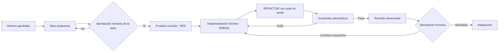

# Harness de desarrollo asistido por IA, SDD y guardrails

> **Prompt de origen:** §2.3, Prompt 1 — Estructura del monorepo y harness de desarrollo con IA, en [`prompts.md`](../../prompts.md). También es la referencia de guardrails que usan los Prompts §2.6, §6 y §7.
> **Fuente de decisiones aprobadas:** [`README.md`](../../README.md) §2.3 ("Desarrollo asistido por IA (propuesto)"), §2.6 y §7.
> **Estado del documento:** **diseño propuesto, no implementado.** No existen `AGENTS.md`, `CLAUDE.md`, `.claude/`, `openspec/`, `.github/workflows/`, skills, hooks ni subagentes configurados. OpenSpec no está instalado. Ninguna regla de este documento se aplica todavía de forma automática.

## 1. Objetivo del harness

Que los agentes de IA desarrollen de forma **consistente, reproducible y supervisada**:

- La especificación aprobada gobierna el comportamiento.
- Las pruebas se escriben antes que la implementación.
- Quien implementa no modifica las pruebas para que pasen.
- Ningún agente aprueba sus propios cambios.
- La decisión final siempre es humana.

## 2. Estructura propuesta

```text
AI4Devs-finalproject-DBADT/      (propuesta, NO implementada)
├── AGENTS.md o CLAUDE.md        # Reglas persistentes; una alternativa según el asistente adoptado
├── .claude/                     # Solo si se adopta Claude Code
│   ├── agents/                  # Definiciones de subagentes por responsabilidad
│   └── skills/                  # Procedimientos reutilizables
├── openspec/                    # Solo si se aprueba OpenSpec
│   ├── specs/                   # Comportamiento vigente
│   └── changes/                 # Propuestas y deltas por cambio
└── .github/workflows/           # CI y guardrails propuestos
```

README §2.3 resume esta propuesta y remite a este documento, que conserva el árbol. `AGENTS.md` y `CLAUDE.md` son **alternativas**: no se exige mantener ambos. La configuración de hooks dependería del asistente adoptado y no se ubica aquí.

**Hecho de esta ejecución:** Claude Code se utilizó para redactar esta documentación, sin un harness configurado. Esto no equivale a haber adoptado Claude Code para el desarrollo: esa decisión sigue pendiente (§10).

## 3. Reglas persistentes para agentes (contenido propuesto del archivo de instrucciones)

| ID | Regla | Tipo |
|---|---|---|
| AR-01 | No modificar el alcance: F01–F07, las 15 tablas, los 3 endpoints aprobados y HU-001–HU-003 | Instrucción, reforzada por GR-05 y GR-07 |
| AR-02 | No añadir tecnologías, dependencias, rutas ni entidades sin aprobación humana | Instrucción, reforzada por GR-05, GR-07 y la revisión humana |
| AR-03 | Leer la spec o la historia aplicable antes de escribir pruebas o código | Instrucción, reforzada por GR-01 |
| AR-04 | Escribir las pruebas antes que la implementación y conservar la evidencia RED | Instrucción, reforzada por GR-02 |
| AR-05 | El agente implementador no edita archivos de prueba | Instrucción, reforzada por GR-06 |
| AR-06 | No declarar como ejecutado algo que no se ejecutó; citar comandos y resultados reales | Instrucción, reforzada por la revisión adversarial y la humana |
| AR-07 | No incluir secretos ni datos personales reales en código, pruebas o logs | Instrucción, reforzada por GR-10 |
| AR-08 | Respetar Controller → Service → Repository y las responsabilidades de [`components.md`](../architecture/components.md) | Instrucción, reforzada por la revisión adversarial |
| AR-09 | Detenerse y pedir decisión humana ante ambigüedades o conflictos | Instrucción |
| AR-10 | No hacer commits, push, merges ni despliegues sin autorización expresa | Instrucción, reforzada por la protección de rama |

## 4. Subagentes especializados y límites

| Papel | Responsabilidad | Puede escribir en | No puede |
|---|---|---|---|
| Agente de especificaciones | Traducir historias aprobadas a requisitos y escenarios observables | `openspec/changes/` (si se adopta) | Cambiar el alcance; aprobar specs |
| Agente de testing | Escribir pruebas desde la spec y demostrar RED | `*_test.go`, `backend/tests/`, `tests/e2e/`, pruebas del frontend | Escribir código de producción |
| Agente implementador | Implementar lo mínimo para GREEN y refactorizar | `frontend/src/`, `backend/internal/`, `backend/cmd/`, `database/` | Editar pruebas, specs ni contratos |
| Revisor adversarial | Contrastar los cambios con specs y contratos; buscar errores, casos límite, riesgos de seguridad y supuestos incorrectos | Solo su informe de hallazgos | Modificar código o pruebas; aprobar |
| Responsable humano | Aprobar alcance, specs, contratos, decisiones, hallazgos y merge | Todo | Delegar la aprobación final en un agente |

**Separación de responsabilidades:** un mismo agente no puede ser autor y revisor del mismo cambio. Si una prueba parece incorrecta, el implementador lo informa y el cambio de la prueba pasa por el agente de testing y por aprobación humana.

## 5. Skills y hooks propuestos

Ejemplos de diseño, no selección ni implementación (README §2.3).

| ID | Skill | Entrada | Salida esperada |
|---|---|---|---|
| SK-01 | Historia a spec | Historia aprobada | Requisitos y escenarios con IDs `HU-00x-Rxx` / `HU-00x-Sxx` |
| SK-02 | Spec a pruebas | Escenarios aprobados | Pruebas que fallan por la ausencia del comportamiento |
| SK-03 | Verificación | Rama de trabajo | Resultados reales de pruebas, lint, contrato y seguridad |
| SK-04 | Evidencias del PR | Resultados de SK-03 | Descripción del PR según la [plantilla](../delivery/pull-requests/pr-process.md#1-plantilla-de-descripción-de-pull-request) |

| ID | Hook | Momento | Propósito |
|---|---|---|---|
| HK-01 | Formato | Tras editar un archivo | Aplicar el formato del lenguaje |
| HK-02 | Rutas protegidas | Antes de que el implementador edite | Bloquear la edición de pruebas, specs y `openspec/specs/` |
| HK-03 | Comprobación rápida | Antes de terminar la tarea | Ejecutar las pruebas afectadas |

Un hook o skill solo se considerará efectivo cuando se haya definido, configurado y probado.

## 6. Flujo de trabajo



### 6.1. Puntos de aprobación humana

| ID | Momento | Qué se aprueba |
|---|---|---|
| HAP-01 | Antes de escribir pruebas | Spec: requisitos y escenarios |
| HAP-02 | Ante cualquier cambio de una prueba existente | Justificación del cambio |
| HAP-03 | Ante cambios de contrato, esquema o dependencias | Impacto y compatibilidad |
| HAP-04 | Tras la revisión adversarial | Resolución o justificación de cada hallazgo |
| HAP-05 | Antes de integrar | Merge del PR |
| HAP-06 | Antes de desplegar o ejecutar una migración destructiva | Ejecución en el ambiente |

## 7. Catálogo de guardrails

Los guardrails son **comprobaciones verificables e independientes del agente**. Una regla escrita en un archivo de instrucciones no es un guardrail hasta que existe un control que la verifica.

| ID | Guardrail | Condición de bloqueo prevista | Automático o humano | Aplica a | Estado |
|---|---|---|---|---|---|
| GR-01 | Spec referenciada | El PR no cita historia, requisitos y escenarios aprobados | Comprobación de la plantilla + revisión humana | PR con código | Propuesto |
| GR-02 | Evidencia RED | Una regla nueva no tiene evidencia de que su prueba falló antes de implementarse | Humano, con evidencia aportada | PR con código | Propuesto |
| GR-03 | Suite de pruebas | Fallan las pruebas unitarias o de integración | Automático (CI) | PR con código | Propuesto |
| GR-04 | Cobertura | Los servicios de negocio no alcanzan el 80 % medido con `go test -cover` | Automático (CI) | PR de backend | Meta aprobada; control no configurado |
| GR-05 | Contrato OpenAPI | El YAML no pasa el lint, o las rutas implementadas no coinciden con el contrato aprobado | Automático, una vez configurado el comparador | PR que afecte API o contrato | Propuesto; comparador por diseñar |
| GR-06 | Integridad de pruebas | El agente implementador modificó archivos de prueba sin HAP-02 | Automático (rutas y autoría) + humano | PR con código | Propuesto |
| GR-07 | Migraciones y esquema | Las migraciones no aplican sobre una base limpia o el esquema no coincide con las 15 tablas | Automático (integración) | PR de base de datos | Propuesto |
| GR-08 | Lint, typecheck y compilación | Falla la compilación, el typecheck o el lint de Go o Next.js | Automático (CI) | PR con código | Propuesto |
| GR-09 | Vulnerabilidades | `govulncheck` informa vulnerabilidades sin tratar | Automático (CI) + humano | PR de backend | Propuesto; herramienta para Next.js no seleccionada |
| GR-10 | Secretos | Se detectan credenciales en el cambio | Automático, cuando se seleccione la herramienta | Todo PR | Propuesto; herramienta no seleccionada |
| GR-11 | Revisión adversarial | Hay hallazgos bloqueantes sin resolver ni justificar | Humano | PR con código | Propuesto |
| GR-12 | Aprobación humana | No hay aprobación del responsable | Humano (protección de rama) | Todo PR | Propuesto |
| GR-13 | Calidad documental | Mermaid inválido, enlaces rotos, YAML inválido o estados confundidos | Automático + humano | PR documental (PR001) | Propuesto; en esta ejecución se ejecutó manualmente (ver [`traceability.md`](traceability.md#4-validaciones-ejecutadas-en-esta-ejecución)) |

**Regla general:** un control que no esté configurado **no cuenta como superado**. Mientras falte, su condición la debe verificar un humano con evidencia o marcarse como "no aplicada".

## 8. Instrucciones frente a controles verificables

| Necesidad | Solo como instrucción | Requiere guardrail |
|---|---|---|
| No ampliar el alcance | AR-01 | GR-05 (rutas), GR-07 (tablas) |
| Tests antes que código | AR-04 | GR-02 |
| No editar tests para que pasen | AR-05 | GR-06 |
| Calidad mínima | — | GR-03, GR-04, GR-08 |
| Seguridad | AR-07 | GR-09, GR-10 |
| Decisión final humana | AR-09 | GR-12 |
| Estilo de redacción y explicaciones | AR-06 | No requiere (revisión humana) |

## 9. Justificación

- **Separación de responsabilidades entre agentes:** reduce el riesgo de que un mismo agente "cierre el círculo" ajustando pruebas a su implementación.
- **Guardrails deterministas:** las comprobaciones con herramientas no dependen de que un modelo siga las instrucciones.
- **Puntos de aprobación explícitos:** mantienen al responsable humano como única fuente de autorización.
- **Estructura opcional:** `.claude/` y `openspec/` solo existen si se aprueba la herramienta correspondiente, lo que evita introducir herramientas sin autorización.

## 10. Decisiones pendientes

| Decisión | Estado |
|---|---|
| Adoptar OpenSpec | Pendiente |
| Asistente de IA para el desarrollo y su archivo de instrucciones (`AGENTS.md` o `CLAUDE.md`) | Pendiente |
| Skills y hooks concretos | Pendiente |
| Herramientas para GR-05 (comparador), GR-09 (Next.js) y GR-10 (secretos) | Pendiente |
| Severidades de la revisión adversarial que bloquean la integración | Propuesta en [`pr-process.md`](../delivery/pull-requests/pr-process.md#3-revisión-adversarial), pendiente de aprobación |
