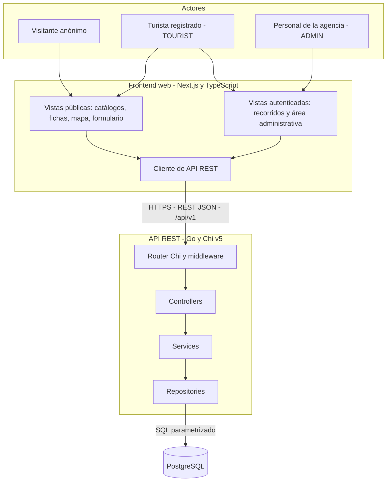
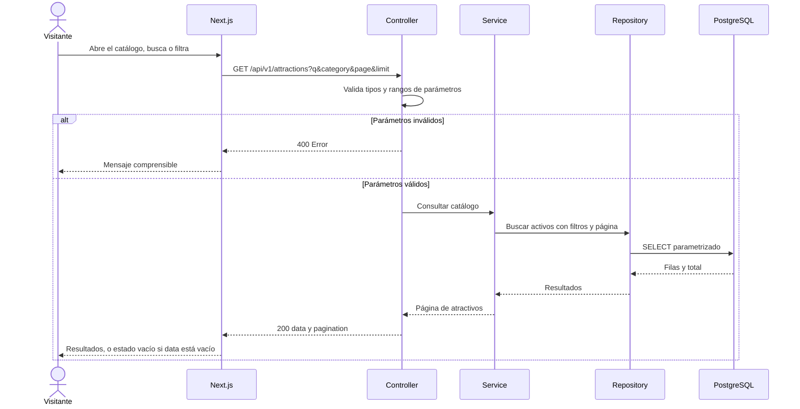
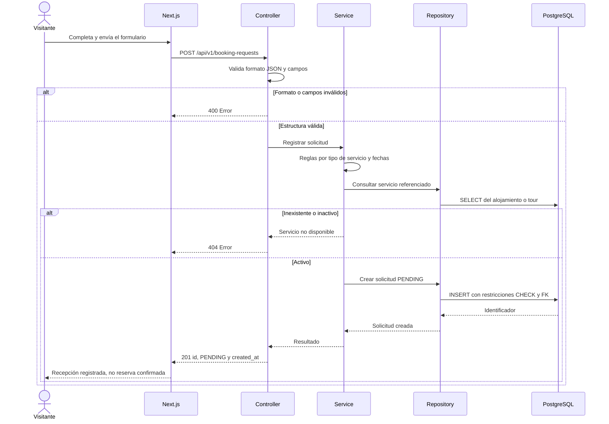
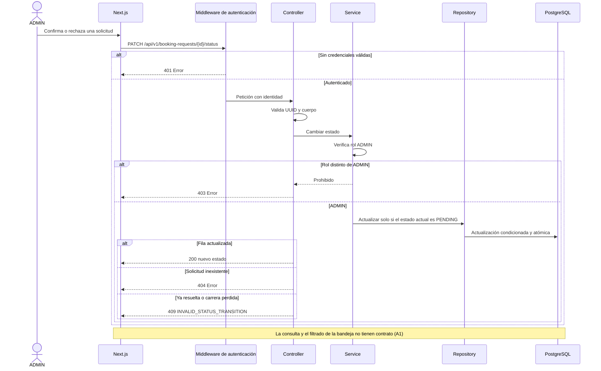

# Arquitectura del sistema

> **Prompt de origen:** §2.1, Prompt 1 — Diseño de arquitectura del sistema, en [`prompts.md`](../../prompts.md).
> **Fuente de decisiones aprobadas:** [`README.md`](../../README.md) §2.1–§2.4 y §4.
> **Estado del documento:** diseño aprobado en cuanto a tecnologías y patrón; ningún componente está implementado ni desplegado. Los diagramas describen el diseño, no una ejecución.

## 1. Tecnologías y organización aprobadas

| Aspecto | Decisión | Registro |
|---|---|---|
| Frontend | Next.js + TypeScript | [ADR-D01](decisions/ADR-D01-stack.md) |
| Backend | Go + Chi v5 | [ADR-D01](decisions/ADR-D01-stack.md) |
| Patrón del backend | Controller → Service → Repository | [ADR-D02](decisions/ADR-D02-backend-layers.md) |
| Base de datos | PostgreSQL | [ADR-D02](decisions/ADR-D02-backend-layers.md) |
| Infraestructura | Docker + Coolify en VPS KVM 4 propio | [ADR-D03](decisions/ADR-D03-infrastructure.md) |
| Organización del código | Monorepo | [ADR-D04](decisions/ADR-D04-monorepo.md) |
| Autenticación | Sin seleccionar | [ADR-P01](decisions/ADR-P01-authentication.md) (pendiente) |

## 2. Diagrama de arquitectura

Los bloques "Vistas públicas", "Vistas autenticadas" y "Cliente de API REST" son agrupaciones lógicas del frontend (ver [`components.md`](components.md)), no componentes o tecnologías nuevas. La flecha entre el cliente y el router representa el contrato REST/JSON, **no** si el cliente se ejecuta en el navegador o en el servidor de Next.js; esa decisión está pendiente (§4.1).

## 3. Funcionalidades y componentes responsables

| Funcionalidad | Frontend | Backend (Service) | Persistencia | Contrato API aprobado |
|---|---|---|---|---|
| F01 Atractivos | Catálogo, filtros, fichas | Filtrado de activos y paginación | `attractions`, `categories`, `attraction_categories`, `attraction_images` | `GET /api/v1/attractions` |
| F02 Alojamientos | Catálogo y ficha | Consulta y activación | `accommodations`, `amenities`, `accommodation_amenities`, `accommodation_images` | No definido |
| F03 Tours | Catálogo y ficha | Consulta y publicación | `tours`, `tour_categories`, `tour_images` | No definido |
| F04 Solicitudes | Formulario y confirmación | Validación y alta `PENDING` | `booking_requests` | `POST /api/v1/booking-requests` |
| F05 Administración | Bandeja y detalle | Autorización `ADMIN` y transición atómica | `booking_requests` | `PATCH /api/v1/booking-requests/{id}/status` (el listado está pendiente, A1) |
| F06 Mapa | Marcadores y navegación geográfica | Consulta de coordenadas | Coordenadas de `attractions` y `accommodations` | No definido |
| F07 Recorridos | Editor por días y orden | Propiedad y reglas del plan | `travel_plans`, `travel_plan_items` | No definido |

"No definido" significa que la funcionalidad está aprobada, pero su contrato no forma parte de los tres endpoints documentados. No se proponen rutas nuevas; cualquier contrato adicional requiere autorización (README §4).

## 4. Comunicación entre frontend, API y base de datos

| Tramo | Protocolo y formato | Reglas |
|---|---|---|
| Navegador → frontend | HTTPS | Páginas públicas sin autenticación (README §1.3) |
| Frontend → API | HTTPS, REST/JSON, prefijo `/api/v1` | El contrato OpenAPI es la fuente común ([`openapi.yaml`](../api/openapi.yaml)) |
| API → PostgreSQL | Red privada; SQL parametrizado | PostgreSQL nunca se expone públicamente (README §2.4–§2.5) |
| Navegador → PostgreSQL | No existe | Prohibido por diseño (README §2.2) |

### 4.1. Exposición de la API: decisión pendiente (A14)

La forma de comunicación entre Next.js y la API Go **no está definida**. El diagrama de despliegue del README (§2.4) muestra `Proxy HTTPS → Frontend → API` sin decidir si la API se publica. Los diagramas de este documento y de [`deployment.md`](deployment.md) representan la comunicación REST/JSON entre frontend y API **sin elegir ninguna de estas alternativas**. Este apartado es la referencia principal de A14; los demás documentos lo enlazan.

| Aspecto | Alternativa A: API accesible desde el navegador mediante HTTPS | Alternativa B: API privada, consumida a través del servidor Next.js |
|---|---|---|
| Recorrido de la petición | Navegador → proxy HTTPS → API Go | Navegador → proxy HTTPS → servidor Next.js → API Go (red interna) |
| Seguridad | La API es una superficie pública: CORS restringido, rate limiting y límites de tamaño en el borde, credenciales enviadas desde el navegador (afecta a ADR-P01, CSRF y XSS) | La API no se expone a Internet. Next.js pasa a ser la única superficie pública y debe propagar la identidad del usuario a la API sin filtrar credenciales |
| Infraestructura | Una ruta adicional del proxy hacia la API, con su certificado o subdominio; dos servicios públicos que monitorear | La API solo necesita red interna; el contenedor de Next.js asume más tráfico y procesamiento |
| Mantenimiento | Frontend y API se despliegan y evolucionan de forma independiente; el contrato OpenAPI se consume directamente | Capa intermedia en Next.js que hay que mantener alineada con el contrato; los cambios de la API pueden requerir cambios en el servidor Next.js |
| Renderizado de Next.js | Compatible con renderizado en cliente o en servidor | Implica que las llamadas se hagan desde el servidor de Next.js |
| Pruebas | Pruebas de contrato contra la API pública; E2E con CORS real | Pruebas adicionales de la capa intermedia de Next.js |

**Estado:** pendiente. No se recomienda ni se elige ninguna alternativa. La decisión condiciona ADR-P01 (autenticación), los controles de [`security.md`](security.md#6-validación-de-entradas-ataques-comunes-y-manejo-de-errores) y la topología de [`deployment.md`](deployment.md#2-distribución-de-componentes).

## 5. Flujos representados

### 5.1. Consulta turística (HU-001)

### 5.2. Solicitud de reserva (HU-002)

La consulta del servicio y la inserción pueden quedar separadas por una desactivación concurrente del servicio. El tratamiento transaccional de ese caso es una decisión de implementación pendiente; se analiza en [`data-model.md`](../data/data-model.md#71-solicitudes-de-reserva).

### 5.3. Gestión administrativa (HU-003)

La verificación de autenticación aparece como middleware porque el README sitúa `middleware/` en la estructura del backend (§2.3). Su implementación depende de ADR-P01.

## 6. Justificación técnica

| Criterio | Cómo lo atiende la arquitectura |
|---|---|
| Separación de responsabilidades | Presentación (Next.js), reglas (Services) y persistencia (Repositories) separadas |
| Requisitos de integridad (F04, F05) | Las reglas y transiciones se ejecutan en Go y PostgreSQL, no en el navegador |
| Concurrencia en F05 | La actualización condicionada en PostgreSQL garantiza que solo prospere la primera resolución |
| Testabilidad | Services testeables de forma aislada; integración con PostgreSQL real (README §2.6) |
| Experiencia responsive | Next.js para la interfaz web adaptable |
| Operación controlada | Contenedores independientes desplegados con Coolify |

## 7. Ventajas, limitaciones y riesgos

**Ventajas (README §2.1):** separación de responsabilidades; servicios testeables de forma aislada; la lógica de negocio no queda acoplada a HTTP ni a SQL; frontend y backend se desarrollan y despliegan por separado.

**Limitaciones (README §2.1):** coordinación mediante un contrato API explícito; dos procesos de compilación, ejecución y despliegue.

| Riesgo técnico | Impacto | Mitigación prevista | Estado |
|---|---|---|---|
| Desincronización entre frontend y contrato | Errores de integración | OpenAPI versionado y control de contrato (GR-05 en [`sdd-harness.md`](../ai/sdd-harness.md#7-catálogo-de-guardrails)) | Propuesto |
| Un único VPS | Punto único de falla | Backups externos y recuperación ([`deployment.md`](deployment.md)) | Propuesto; A8, A15 |
| Autenticación sin definir | Bloquea F05 y F07 | ADR-P01 antes de implementar | Pendiente |
| Exposición de la API sin definir | Afecta CORS, seguridad, infraestructura y renderizado | Decidir entre las alternativas de §4.1 (A14) | Pendiente |
| Sobrefragmentación de capas | Complejidad innecesaria | Crear capas por necesidad real (ADR-D02) | Aprobado como criterio |
| Funcionalidades sin contrato API (F02, F03, F06, F07 y el listado de F05) | Trabajo bloqueado hasta definir su contrato | Formalizar y aprobar cada contrato antes de implementarlo | Pendiente (A1, A10) |

## 8. Decisiones pendientes

| Código | Decisión | Documento |
|---|---|---|
| A1 | Contrato de consulta y filtrado administrativo | [`api-reference.md`](../api/api-reference.md) |
| A5 | Mecanismo de autenticación | [ADR-P01](decisions/ADR-P01-authentication.md) |
| A14 | Exposición de la API (alternativas A y B) y estrategia de renderizado | §4.1 |
| A8, A15 | Mecanismo, proveedor, frecuencia y retención de los backups externos al VPS principal, y procedimiento de recuperación | [`deployment.md`](deployment.md) |

No se incorporan microservicios, servicios adicionales, pagos ni disponibilidad en tiempo real.
