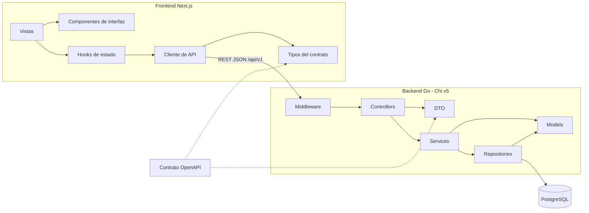

# Componentes y responsabilidades

> **Prompt de origen:** §2.2, Prompt 1 — Definición de componentes y responsabilidades, en [`prompts.md`](../../prompts.md).
> **Fuente de decisiones aprobadas:** [`README.md`](../../README.md) §2.2 y §2.3 (estructura de carpetas).
> **Estado del documento:** diseño de componentes; ningún componente está implementado.

Los nombres de componentes son **agrupaciones lógicas** dentro de la estructura de carpetas aprobada. No introducen tecnologías, rutas ni funcionalidades.

## 1. Componentes del frontend (Next.js + TypeScript)

| Componente lógico | Responsabilidad | Ubicación prevista (README §2.3) | Funcionalidades |
|---|---|---|---|
| Vistas de catálogo | Listar, buscar, filtrar y paginar atractivos, alojamientos y tours | `src/app/` | F01, F02, F03 |
| Vistas de ficha | Mostrar galería, descripción, ubicación y acciones | `src/app/` | F01, F02, F03 |
| Formulario de solicitud | Recoger y prevalidar datos; mostrar la recepción | `src/app/`, `src/components/` | F04 |
| Vista de mapa | Mostrar marcadores filtrables y enlazar con las fichas | `src/app/`, `src/components/` | F06 |
| Planificador | Editar días y orden; listar los recorridos propios | `src/app/`, `src/components/` | F07 |
| Área administrativa | Bandeja, detalle y acciones de resolución | `src/app/` | F05 |
| Componentes de interfaz reutilizables | Tarjetas, filtros, paginación, galería, estados ([`ux-design.md`](../product/ux-design.md#8-componentes-visuales-reutilizables)) | `src/components/` | Todas |
| Lógica de estado de interfaz | Carga, error, vacío y estado de los formularios | `src/hooks/` | Todas |
| Cliente de API | Llamadas REST/JSON y traducción de errores a mensajes | `src/services/` | Todas |
| Tipos del contrato | Tipos TypeScript alineados con OpenAPI | `src/types/` | Todas |
| Utilidades | Formato de fechas y textos | `src/lib/` | Todas |
| Gestión de sesión | Estado de autenticación en el cliente | Por definir | F05, F07; depende de A5 |

## 2. Componentes del backend (Go + Chi v5)

| Capa o paquete (README §2.3) | Responsabilidad | No debe hacer |
|---|---|---|
| `cmd/api/` | Punto de entrada: configuración, router y arranque del servidor | Contener reglas de negocio |
| `internal/config/` | Leer la configuración desde variables de entorno | Guardar secretos en el código |
| `internal/middleware/` | Funciones transversales previstas: autenticación (A5), límites de tamaño y tiempo, rate limiting (parámetros pendientes), registro de peticiones sin datos personales | Decidir reglas de negocio específicas |
| `internal/controllers/` | Leer la petición, validar formato y tipos, invocar el servicio y traducir el resultado a HTTP y JSON | Acceder a PostgreSQL o aplicar reglas de negocio |
| `internal/dto/` | Estructuras de entrada y salida HTTP alineadas con OpenAPI | Exponer campos internos innecesarios |
| `internal/services/` | Reglas de negocio, autorización por rol y propiedad, orquestación de transacciones | Conocer detalles de HTTP o construir SQL |
| `internal/repositories/` | Consultas parametrizadas, transacciones y actualización condicionada | Decidir permisos o reglas funcionales |
| `internal/models/` | Entidades de dominio correspondientes a las 15 tablas | Depender de HTTP |

### 2.1. Responsabilidades de cada capa en los tres endpoints aprobados

| Endpoint | Controller | Service | Repository |
|---|---|---|---|
| `GET /api/v1/attractions` | Validar `q`, `category`, `page` (≥1) y `limit` (1–100); responder `200` o `400` | Aplicar "solo activos" y calcular la paginación | Consulta filtrada con conteo total |
| `POST /api/v1/booking-requests` | Validar JSON, tipos, campos requeridos y formato de correo y fechas; `201`, `400` o `404` | RN-10 a RN-18 ([`business-flows.md`](../product/business-flows.md#42-bf-02--solicitud-de-reserva)); verificar el servicio activo; asignar `PENDING` | Buscar el servicio; insertar respetando `CHECK` y FK |
| `PATCH /api/v1/booking-requests/{id}/status` | Validar UUID y cuerpo `{status}`; `200`, `400`, `401`, `403`, `404` o `409` | Verificar `ADMIN`; aplicar RN-31 a RN-33 | Actualizar solo si el estado actual es `PENDING`; distinguir inexistente de ya resuelta |

### 2.2. Componentes de backend de funcionalidades sin contrato

F02, F03, F06, F07 y el listado de F05 requieren controllers, services y repositories propios, pero **no tienen contrato API aprobado** (A1, A10). No se definen aquí sus rutas ni sus operaciones.

## 3. Trazabilidad entre componentes y F01–F07

| Componente | F01 | F02 | F03 | F04 | F05 | F06 | F07 |
|---|---|---|---|---|---|---|---|
| Vistas de catálogo y ficha | X | X | X | | | | |
| Formulario de solicitud | | | | X | | | |
| Área administrativa | | | | | X | | |
| Vista de mapa | | | | | | X | |
| Planificador | | | | | | | X |
| Cliente de API y tipos | X | X | X | X | X | X | X |
| Middleware de autenticación | | | | | X | | X |
| Service de atractivos | X | | | | | X | X |
| Service de alojamientos | | X | | X | | X | |
| Service de tours | | | X | X | | | |
| Service de solicitudes | | | | X | X | | |
| Service de recorridos | | | | | | | X |
| Repositories correspondientes | X | X | X | X | X | X | X |
| PostgreSQL (15 tablas) | X | X | X | X | X | X | X |

## 4. Dependencias y comunicaciones

**Reglas de dependencia:**
- Las dependencias van en un solo sentido: Controllers → Services → Repositories. Ninguna capa inferior conoce a la superior.
- El frontend solo conoce el contrato REST, nunca el esquema SQL.
- El contrato OpenAPI es la fuente compartida de tipos y DTO. Cómo se mantienen alineados (manual o con una herramienta) está pendiente de decisión.

## 5. Reglas que se ejecutan exclusivamente en el backend

El frontend puede prevalidar para orientar al usuario, pero estas reglas solo son autoritativas en Go o PostgreSQL (README §2.2, §3.2):

| Regla | Ejecución autoritativa |
|---|---|
| Solo atractivos y servicios activos en las respuestas públicas | Service y Repository |
| Exactamente un alojamiento o un tour por solicitud | Service y `CHECK` de PostgreSQL |
| Coherencia de fechas según el tipo de servicio | Service y `CHECK` |
| `people_count` mayor que cero | Service y `CHECK` |
| Servicio existente y activo | Service |
| Estado inicial `PENDING` | Service y valor por defecto en PostgreSQL |
| Transiciones permitidas y estados finales | Service |
| Primera resolución válida ante concurrencia | Repository (actualización condicionada) |
| Rol `ADMIN` para resolver | Middleware y Service |
| Propiedad del recorrido (`TOURIST` dueño) | Service |
| Asignación de rol `TOURIST` en el registro público | Service |
| Unicidad de correo de usuario, slugs y posiciones del recorrido | PostgreSQL |

## 6. Recomendaciones de bajo acoplamiento y alta cohesión

1. Un service por agregado de negocio (atractivos, alojamientos, tours, solicitudes, recorridos), sin services genéricos que mezclen dominios.
2. Los services reciben interfaces de repositorio para poder probarse con dobles ([`testing-strategy.md`](testing-strategy.md)).
3. Los controllers no comparten estado ni contienen lógica condicional de negocio.
4. Los errores de dominio (validación, no encontrado, conflicto, prohibido) se definen en los services y se traducen a HTTP en los controllers.
5. El frontend centraliza las llamadas en el cliente de API y no reparte URLs por las vistas.
6. No se duplican reglas: el frontend replica solo las validaciones de ayuda y las trata como no autoritativas.

## 7. Decisiones pendientes

| Código | Decisión |
|---|---|
| A1, A10 | Contratos de las funcionalidades sin endpoint |
| A5 | Autenticación y gestión de sesión en el frontend |
| A14 | Exposición de la API y renderizado |
| — | Mecanismo para mantener alineados OpenAPI, DTO y tipos TypeScript |
| C5 | Parámetros de rate limiting y respuesta `429` |
