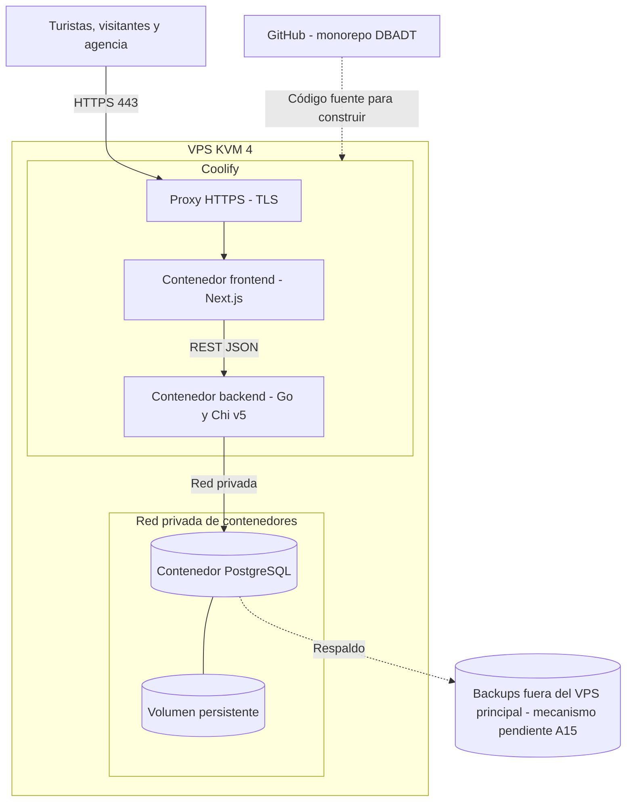
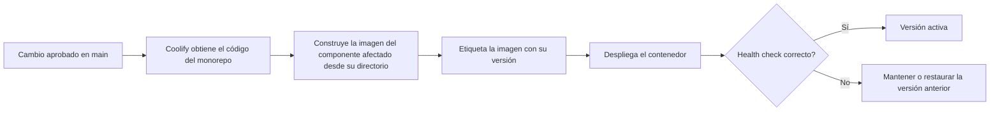

# Infraestructura y despliegue

> **Prompt de origen:** §2.4, Prompt 1 — Diseño de infraestructura y estrategia de despliegue, en [`prompts.md`](../../prompts.md).
> **Fuente de decisiones aprobadas:** [`README.md`](../../README.md) §2.4; [ADR-D03](decisions/ADR-D03-infrastructure.md).
> **Estado del documento:** infraestructura aprobada y **no desplegada**. No se ha instalado Coolify, no existen archivos de configuración ni despliegues, y este documento no los crea.

## 1. Infraestructura aprobada

| Componente | Tecnología | Función |
|---|---|---|
| Servidor | VPS KVM 4 (4 vCPU, 16 GB RAM, 200 GB NVMe, 16 TB de transferencia) | Alojamiento único |
| Plataforma de despliegue | Coolify | Construcción y administración de aplicaciones y contenedores |
| Contenedores | Docker | Aislamiento de frontend, backend y PostgreSQL |
| Frontend | Next.js + TypeScript | Aplicación web |
| Backend | Go + Chi v5 | API REST |
| Base de datos | PostgreSQL con volumen persistente | Persistencia |
| Código | GitHub, monorepo | Origen de los despliegues |

## 2. Distribución de componentes

| Componente | Expuesto públicamente | Comunicación |
|---|---|---|
| Proxy HTTPS | Sí | Termina TLS y enruta hacia el frontend |
| Frontend | A través del proxy | Llama a la API |
| Backend (API) | Pendiente (A14) | Accede a PostgreSQL por la red privada |
| PostgreSQL | **Nunca** | Solo desde el backend autorizado |

El diagrama mantiene la topología del README (`Proxy → Frontend → API`) y **no representa una decisión** sobre la exposición de la API (A14). Si se adopta la alternativa A (API accesible desde el navegador), habrá que añadir una ruta del proxy hacia la API. Con la alternativa B (API privada tras Next.js), la API permanece en la red interna. Implicaciones de seguridad, infraestructura y mantenimiento en [`architecture.md` §4.1](architecture.md#41-exposición-de-la-api-decisión-pendiente-a14).

## 3. Flujo de despliegue y actualización

| Paso | Descripción | Estado |
|---|---|---|
| 1. Control de versiones | Código en GitHub; solo se despliegan cambios integrados tras revisión ([`pr-process.md`](../delivery/pull-requests/pr-process.md)) | Aprobado |
| 2. Integración con Coolify | Configuración del repositorio y de los directorios de frontend y backend | Aprobado; no configurado |
| 3. Disparo del despliegue | Automático al integrar o manual | Pendiente |
| 4. Construcción | Cada aplicación desde su configuración de Docker | Aprobado; los archivos Docker no existen |
| 5. Despliegue independiente | Frontend y backend por separado | Aprobado |
| 6. Migraciones | Antes o como parte del despliegue del backend; las destructivas requieren aprobación (README §3) | Momento de ejecución pendiente |
| 7. Verificación | Health checks y comprobación de la comunicación | Aprobado; endpoints de salud no definidos |

**Orden en un cambio con migración (propuesto):** backup verificado → migración en una base de prueba → migración en el ambiente destino → despliegue del backend → health check → despliegue del frontend si cambió.

## 4. Variables de entorno, secretos y ambientes

| Categoría | Ejemplos de contenido (sin valores) | Gestión |
|---|---|---|
| Conexión a base de datos | Host interno, nombre de la base, usuario, contraseña | Variables secretas en Coolify; nunca en Git |
| Configuración de la API | Puerto, orígenes permitidos (si aplica CORS) | Variables en Coolify |
| Configuración del frontend | URL base de la API | Variables en Coolify |
| Autenticación | Secretos del mecanismo elegido | Pendiente (A5) |

**Reglas aprobadas:** las credenciales no se guardan en el repositorio, y las configuraciones, credenciales y datos de desarrollo o pruebas no se reutilizan en producción (README §2.4). La topología exacta de ambientes está pendiente (A8).

## 5. Seguridad de la infraestructura

| Control | Descripción | Estado |
|---|---|---|
| HTTPS | Certificados TLS para todas las conexiones públicas | Aprobado; mecanismo de emisión pendiente |
| Aislamiento de PostgreSQL | Sin puerto publicado; accesible solo por la red privada | Aprobado |
| Permisos mínimos en la base de datos | Usuario de aplicación sin privilegios de administración | Propuesto (README §2.5) |
| Acceso administrativo a Coolify y al VPS | Restringido al personal autorizado | Aprobado como requisito; mecanismo pendiente |
| Imágenes base | Mantenidas y actualizadas | Aprobado como práctica |
| Revisión de dependencias | Go (`govulncheck`) y Next.js | Propuesto; herramienta para Next.js no seleccionada |

El detalle de riesgos y controles está en [`security.md`](security.md).

## 6. Backups, monitoreo, recuperación y rollback

### 6.1. Backups

| Aspecto | Aprobado | Pendiente |
|---|---|---|
| Alcance | Respaldo de PostgreSQL | Si se incluyen imágenes del catálogo; depende de dónde se alojen las imágenes, que no está definido |
| Ubicación | **Fuera del VPS principal** (requisito aprobado) | Mecanismo y proveedor del almacenamiento externo (A15) |
| Frecuencia y retención | — | Por definir antes de producción (A8) |
| Prueba de restauración | Restaurable | Procedimiento de recuperación y periodicidad de las pruebas (A8) |

**Requisito aprobado y alcance de A15.** Los respaldos de PostgreSQL deben almacenarse fuera del VPS principal (README §2.4; confirmado por el responsable del proyecto en la corrección de cierre CC-1). Siguen pendientes el mecanismo, el proveedor, la frecuencia, la retención y el procedimiento de recuperación. La documentación **no selecciona ni contrata** ningún servicio externo. La restricción del Prompt §2.4 de no introducir servicios cloud externos se respeta: elegir el destino es una decisión pendiente que requiere aprobación, no un servicio incorporado al diseño.

### 6.2. Monitoreo

- Logs de aplicación de frontend y backend, sin datos personales innecesarios.
- Estado de los contenedores desde Coolify.
- Verificación de disponibilidad de los servicios.
- CPU, RAM y almacenamiento del VPS.

Umbrales, alertas y canal de notificación: pendientes.

### 6.3. Recuperación y rollback

| Escenario | Estrategia propuesta | Estado |
|---|---|---|
| Despliegue defectuoso | Volver a la imagen etiquetada anterior | Propuesto; procedimiento por probar |
| Migración defectuosa | Reversión cuando sea segura; si no, restaurar el backup previo | Propuesto |
| Pérdida del VPS | Reconstrucción desde el repositorio y restauración del backup externo | Propuesto; RTO/RPO pendientes |

## 7. Riesgos operativos y limitaciones de un único VPS

| Aspecto | Riesgo | Medida prevista | Decisión pendiente |
|---|---|---|---|
| Disponibilidad | Una falla del host afecta a la interfaz, la API y la base de datos | Health checks y procedimiento de recuperación | RTO/RPO (A8) |
| Datos | Fallo de disco o borrado accidental | Backups restaurables fuera del VPS principal (requisito aprobado) | Mecanismo, proveedor, frecuencia, retención y recuperación (A8, A15) |
| Capacidad | Los procesos compiten por CPU, RAM y disco | Métricas y pruebas de carga con k6 | Umbrales |
| Actualización | Un despliegue defectuoso interrumpe el servicio | Imágenes versionadas y rollback probado | Procedimiento (A8) |
| Secretos | Filtración por el repositorio o los logs | Variables en Coolify y accesos mínimos | — |
| Mantenimiento del host | Actualizaciones del sistema que requieren reinicio | Ventanas de mantenimiento | Política pendiente |

## 8. Decisiones pendientes

| Código | Decisión |
|---|---|
| A8 | Ambientes, dominios, frecuencia y retención de backups, RTO/RPO, procedimiento de rollback |
| A14 | Exposición pública de la API |
| A15 | Mecanismo y proveedor del almacenamiento de backups fuera del VPS principal (el requisito de almacenarlos fuera está aprobado; no se selecciona ningún servicio) |
| — | Despliegue automático o manual, endpoints de health check, emisión de certificados TLS |
