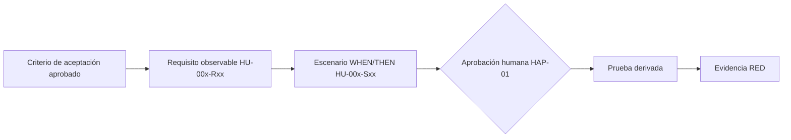
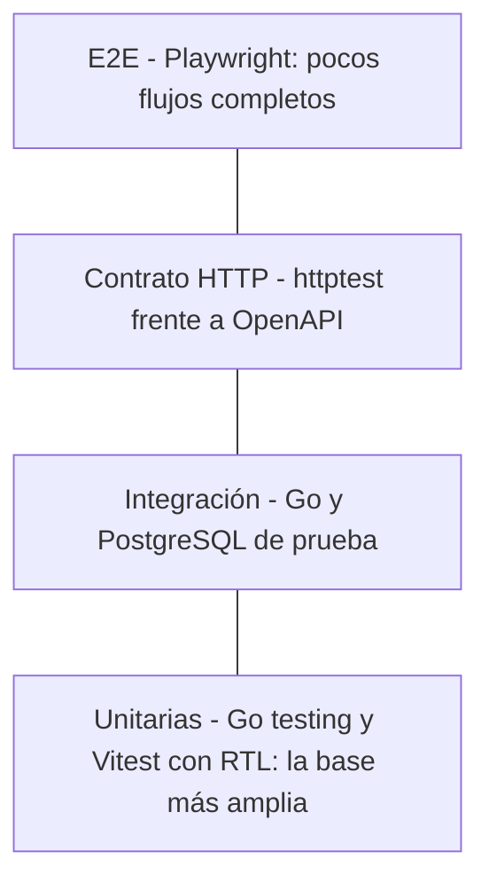

# Estrategia de pruebas: SDD, TDD y guardrails

> **Prompt de origen:** §2.6, Prompt 1 — Estrategia de testing basada en SDD, TDD y guardrails, en [`prompts.md`](../../prompts.md).
> **Fuente de decisiones aprobadas:** [`README.md`](../../README.md) §2.6; historias en [`docs/user-stories/`](../user-stories/HU001.md).
> **Estado del documento:** estrategia **propuesta**. No existen pruebas, suites, reportes ni mediciones de cobertura. OpenSpec y los guardrails no están configurados.

## 1. Principios

1. La especificación aprobada es la referencia de las pruebas y de la implementación.
2. No se considera válida una prueba que nunca demostró fallar cuando correspondía.
3. Ningún agente altera requisitos aprobados ni rebaja pruebas para obtener un resultado verde.
4. Meta aprobada: **80 % de cobertura del código de servicios de negocio**.
5. Las validaciones automáticas se distinguen de las revisiones que requieren intervención humana (§8).

## 2. SDD con OpenSpec (propuesto)

**Estado:** OpenSpec no está instalado ni ejecutado. Los identificadores de este documento son **provisionales y documentales**, no specs OpenSpec creadas (decisión C7).

**Conversión propuesta:**

| Paso | Descripción | Resultado |
|---|---|---|
| 1 | Cada criterio de aceptación de HU-001–HU-003 se convierte en un requisito observable | `HU-00x-Rxx` en los archivos de historia |
| 2 | Cada requisito tiene uno o más escenarios Given/When/Then | `HU-00x-Sxx` |
| 3 | Si se adopta OpenSpec, los requisitos aprobados se trasladan a `openspec/specs/` y los cambios a `openspec/changes/` | Specs versionadas |
| 4 | Ninguna spec se considera aprobada sin revisión humana | HAP-01 |

## 3. Proceso TDD: RED → GREEN → REFACTOR

| Fase | Actividad | Responsable | Evidencia exigida |
|---|---|---|---|
| RED | Escribir la prueba desde el escenario aprobado, sin tocar código de producción; ejecutarla y comprobar que falla **por la razón esperada** | Agente de testing | Salida real del fallo |
| GREEN | Implementar lo mínimo para que pase, sin modificar la prueba | Agente implementador | Salida real de la suite en verde |
| REFACTOR | Mejorar el diseño manteniendo la suite en verde | Agente implementador | Suite completa en verde |
| Verificación | Contrastar con la spec y con OpenAPI; ejecutar los guardrails | Automático + revisor | Resultados de GR-03 a GR-10 |
| Revisión | Revisión adversarial y aprobación humana | Revisor + humano | Hallazgos y decisión |

Un fallo por un error de compilación ajeno al requisito no cuenta como RED válido.

## 4. Pirámide de pruebas y herramientas

| Nivel | Herramienta prevista (README §2.6) | Alcance |
|---|---|---|
| Unitarias de backend | `testing`, `go test` | Services con dobles de repositorio |
| Unitarias de frontend | Vitest + React Testing Library | Componentes, estados y formularios |
| HTTP y contrato | `net/http/httptest` | Controllers: códigos, cuerpos y validación frente al contrato |
| Integración | `go test` con PostgreSQL de prueba aislado | Repositories, restricciones, migraciones y concurrencia |
| E2E | Playwright | Flujos de solicitud y de administración |
| Rendimiento | k6 | Endpoints críticos; sin umbrales asumidos |
| Seguridad de dependencias | `govulncheck` | Backend Go |
| Cobertura | `go test -cover` | Servicios de negocio |

No se incorporan otras herramientas sin aprobación.

## 5. Estrategia por funcionalidad

| Funcionalidad | Unitarias | Integración | Contrato | E2E | Observación |
|---|---|---|---|---|---|
| F01 | Service de atractivos (filtros y paginación); componentes del catálogo | Consulta filtrada sobre PostgreSQL | `GET /api/v1/attractions` | Exploración y filtro | Contrato aprobado |
| F02 | Por derivar | Por derivar | Sin contrato | — | A10 |
| F03 | Por derivar | Por derivar | Sin contrato | — | A10 |
| F04 | Validaciones por tipo de servicio | Inserción y `CHECK` | `POST /api/v1/booking-requests` | Al menos un flujo completo de solicitud (meta aprobada) | Contrato aprobado |
| F05 | Transiciones y autorización | Actualización atómica y concurrencia | `PATCH .../status` | Resolución por `ADMIN` | El listado no tiene contrato (A1) |
| F06 | Por derivar | — | Sin contrato | — | A10 |
| F07 | Por derivar (propiedad, posiciones) | `UNIQUE` de posiciones; atractivos repetidos | Sin contrato | — | A10; las restricciones de datos se prueban en TICKET-003 |

"Por derivar" significa que las pruebas se diseñarán cuando exista una historia o un contrato aprobados. No se inventan aquí.

## 6. Matriz de trazabilidad: requisito → prueba

Los requisitos se definen en [`HU001.md`](../user-stories/HU001.md), [`HU002.md`](../user-stories/HU002.md) y [`HU003.md`](../user-stories/HU003.md).

| Requisito | Prueba a derivar | Nivel y herramienta |
|---|---|---|
| HU-001-R01 Sin registro (las pruebas de R03, R04 y R06 dependen de A16, requisito previo de HU-001) | La petición sin credenciales devuelve `200` | Contrato (`httptest`), E2E |
| HU-001-R02 Solo activos | Los atractivos inactivos no aparecen | Service (unitaria), integración |
| HU-001-R03 Búsqueda por nombre | `q` devuelve coincidencias | Service, integración |
| HU-001-R04 Filtro por categoría | `category` devuelve solo esa categoría | Service, integración, E2E |
| HU-001-R05 Datos mostrados | Tarjeta con nombre, descripción, ubicación e imágenes en orden | Vitest/RTL |
| HU-001-R06 Paginación | `page` y `limit` respetados; `limit` fuera de rango devuelve `400` | Contrato, integración |
| HU-001-R07 Sin coincidencias | `data` vacío y estado vacío en la interfaz, sin error | Contrato, Vitest/RTL |
| HU-002-R01 Sin registro | `POST` sin credenciales devuelve `201` | Contrato |
| HU-002-R02 Servicio activo | Servicio inactivo o inexistente devuelve `404` y no persiste | Service, integración |
| HU-002-R03 Campos requeridos | Falta de nombre, correo, fecha o personas devuelve `400` | Contrato, Service |
| HU-002-R04 Opcionales | Sin teléfono ni observaciones devuelve `201` | Contrato |
| HU-002-R05 Fechas de alojamiento | Salida menor o igual que la entrada devuelve `400` y no persiste | Service, integración (`CHECK`) |
| HU-002-R06 Fecha de tour | Tour con `end_date` devuelve `400` | Service, contrato |
| HU-002-R07 Mensajes de validación | La interfaz muestra un error por campo | Vitest/RTL |
| HU-002-R08 Estado `PENDING` | La fila persistida queda en `PENDING` | Integración |
| HU-002-R09 Referencia | La respuesta incluye `id` | Contrato, E2E |
| HU-002-R10 Sin pago ni disponibilidad | El mensaje de recepción no afirma confirmación | Vitest/RTL, E2E |
| HU-003-R01 Sesión requerida | Sin credenciales devuelve `401` | Contrato |
| HU-003-R02 Solo `ADMIN` | `TOURIST` recibe `403` | Service, contrato |
| HU-003-R03, R04, R05 Consulta, filtros y detalle | **Sin contrato (A1)**; no se derivan pruebas de API | — |
| HU-003-R06 Nuevas en `PENDING` | Cubierto por HU-002-R08 | Integración |
| HU-003-R07 Transiciones válidas | `PENDING` pasa a `CONFIRMED` o `REJECTED` con `200` | Service, integración |
| HU-003-R08 Estados finales | Cambiar una solicitud resuelta devuelve `409` sin modificarla | Service, integración |
| HU-003-R09 Concurrencia | Dos resoluciones simultáneas: una `200` y otra `409` | Integración con PostgreSQL |
| HU-003-R10 Errores sin efectos | Tras `400`, `403`, `404` o `409` el estado no cambia | Integración |

## 7. Escenarios críticos

| Área | Escenario | Por qué es crítico |
|---|---|---|
| Solicitudes | Alojamiento y tour a la vez, o ninguno | Integridad del modelo (`CHECK`) |
| Solicitudes | Servicio desactivado entre la consulta y la inserción | Condición de carrera ([`data-model.md`](../data/data-model.md#71-solicitudes-de-reserva)) |
| Solicitudes | Fechas límite: salida igual a la entrada | Borde de RN-14 |
| Autorización | `TOURIST` y anónimo frente al `PATCH` | Elevación de privilegios |
| Autorización | Credencial expirada o manipulada | Depende de A5; diseño pendiente |
| Concurrencia | Dos `ADMIN` resuelven la misma solicitud | RN-33 |
| Transiciones | `CONFIRMED → REJECTED`, `REJECTED → CONFIRMED`, `PENDING → PENDING` | RN-31 y RN-32 |
| Transiciones | Estado inexistente en el cuerpo (`"CANCELLED"`) | Validación de enumeración (`400`) |
| Recorridos | Posición duplicada frente a atractivo repetido | RN-41 y RN-42 |

## 8. Validaciones automáticas frente a revisiones humanas

| Verificación | Tipo |
|---|---|
| Pruebas, compilación, lint y cobertura | Automática (GR-03, GR-04, GR-08) |
| Lint del contrato OpenAPI | Automática (GR-05) |
| Vulnerabilidades de Go | Automática (GR-09) |
| Evidencia RED válida | Humana, con evidencia (GR-02) |
| Adecuación de la spec a la historia | Humana (HAP-01) |
| Justificación de cambios en pruebas | Humana (HAP-02) |
| Hallazgos de la revisión adversarial | Humana (GR-11) |
| Accesibilidad y responsive | Mixta: pruebas E2E más revisión humana; no se declara conformidad WCAG |

Catálogo completo de guardrails: [`sdd-harness.md`](../ai/sdd-harness.md#7-catálogo-de-guardrails).

## 9. Criterios de calidad para aprobar una entrega con código

1. Todos los requisitos de las historias incluidas tienen pruebas trazables (§6).
2. Hay evidencia RED de cada regla nueva.
3. La suite unitaria y la de integración están en verde en un entorno aislado.
4. Cobertura de servicios de negocio igual o mayor al 80 %, medida con `go test -cover`.
5. El contrato OpenAPI pasa el lint y coincide con las rutas implementadas.
6. `govulncheck` no informa vulnerabilidades sin tratar.
7. Al menos un flujo E2E completo de solicitud de reserva.
8. Los hallazgos adversariales están resueltos o justificados, y existe aprobación humana.

## 10. Decisiones pendientes

| Decisión | Referencia |
|---|---|
| Adopción de OpenSpec | [`sdd-harness.md`](../ai/sdd-harness.md#10-decisiones-pendientes) |
| Pruebas de F02, F03, F06 y F07 | A10 |
| Contrato del listado de HU-003 | A1 |
| Pruebas de autenticación | A5 |
| Umbrales de rendimiento | Sin línea base; no se asumen |
| Ubicación de las pruebas del frontend | [`repository-structure.md`](repository-structure.md#4-convenciones-de-pruebas-readme-23) |
