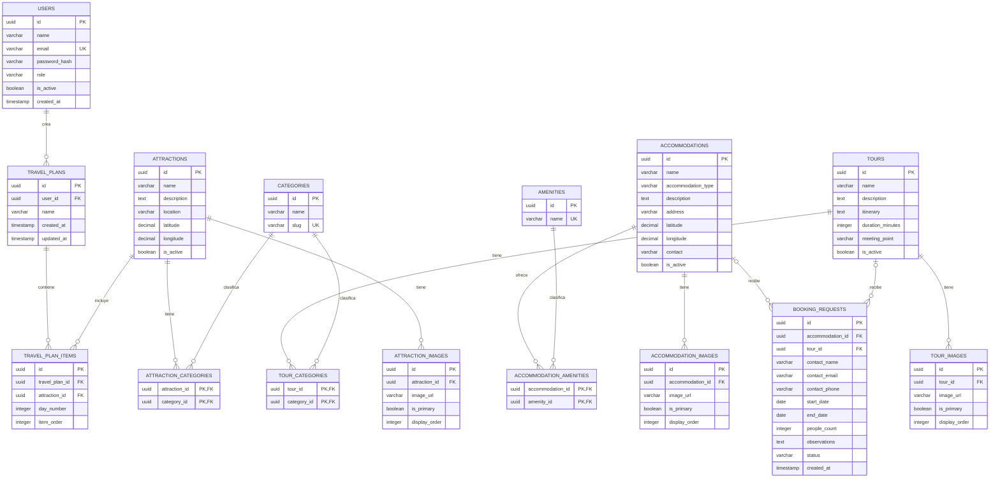

# Modelo de datos

> **Prompt de origen:** §3, Prompt 1 — Diseño del modelo de datos relacional, en [`prompts.md`](../../prompts.md).
> **Fuente de decisiones aprobadas:** [`README.md`](../../README.md) §3.1 y §3.2; restricciones de TICKET-003 (README §6).
> **Estado del documento:** modelo conceptual y restricciones **aprobados**; esquema físico y migraciones **no implementados**. No contiene DDL ejecutado ni migraciones SQL.

Este documento es la referencia principal de **restricciones físicas, índices y estrategia de migraciones**.

## 1. Alcance: 15 tablas aprobadas

| N.º | Tabla | Grupo | Funcionalidades |
|---|---|---|---|
| 1 | `users` | Usuarios | F05, F07 |
| 2 | `categories` | Categorías | F01, F03 |
| 3 | `attractions` | Atractivos | F01, F06, F07 |
| 4 | `attraction_categories` | Categorías | F01 |
| 5 | `attraction_images` | Atractivos | F01 |
| 6 | `accommodations` | Alojamientos | F02, F04, F06 |
| 7 | `amenities` | Alojamientos | F02 |
| 8 | `accommodation_amenities` | Alojamientos | F02 |
| 9 | `accommodation_images` | Alojamientos | F02 |
| 10 | `tours` | Tours | F03, F04 |
| 11 | `tour_categories` | Categorías | F03 |
| 12 | `tour_images` | Tours | F03 |
| 13 | `booking_requests` | Reservas | F04, F05 |
| 14 | `travel_plans` | Planificador | F07 |
| 15 | `travel_plan_items` | Planificador | F07 |

**Total: 15 tablas.** No se añaden entidades ni relaciones. Expresamente no existen `tour_stops`, tablas de pagos, de disponibilidad, de sesiones ni de auditoría.

## 2. Diagrama entidad-relación

El diagrama es el aprobado en README §3.1, sin cambios de entidades, atributos ni relaciones.

## 3. Diccionario de datos

**Leyenda de obligatoriedad:**
- **Sí** / **No**: obligatoriedad aprobada; este diccionario es su referencia vigente.
- **Implícita**: necesaria por la regla aprobada, pero no declarada como `NOT NULL`.
- **No definida**: decisión pendiente; no se inventa.

**Tipos:** son conceptuales. Los tamaños de `VARCHAR`, la precisión de `DECIMAL`, el uso de zona horaria en `TIMESTAMP` y los valores por defecto físicos están pendientes (A6).

### 3.1. `users`

| Columna | Tipo | Obligatoria | Restricciones y reglas | Estado |
|---|---|---|---|---|
| `id` | UUID | Sí | PK | Aprobado |
| `name` | VARCHAR | No definida | — | Aprobado (campo) |
| `email` | VARCHAR | Sí | `UNIQUE` | Aprobado |
| `password_hash` | VARCHAR | No definida | Depende del mecanismo de autenticación | Campo aprobado; uso pendiente (A5) |
| `role` | VARCHAR | Implícita | Valores `TOURIST` y `ADMIN`; el registro público asigna `TOURIST` | Aprobado |
| `is_active` | BOOLEAN | Implícita | Valor inicial `true` | Aprobado |
| `created_at` | TIMESTAMP | No definida | — | Aprobado (campo); zona horaria pendiente (A6) |

### 3.2. `categories`

| Columna | Tipo | Obligatoria | Restricciones y reglas | Estado |
|---|---|---|---|---|
| `id` | UUID | Sí | PK | Aprobado |
| `name` | VARCHAR | Sí | — | Aprobado |
| `slug` | VARCHAR | Sí | `UNIQUE` | Aprobado |

El catálogo de categorías es compartido por atractivos y tours.

### 3.3. `attractions`

| Columna | Tipo | Obligatoria | Restricciones y reglas | Estado |
|---|---|---|---|---|
| `id` | UUID | Sí | PK | Aprobado |
| `name` | VARCHAR | Sí | — | Aprobado (restricción propuesta en el modelo de datos) |
| `description` | TEXT | No definida | — | Aprobado (campo) |
| `location` | VARCHAR | No definida | Ubicación textual | Aprobado (campo) |
| `latitude` | DECIMAL | No definida (OpenAPI la declara `nullable`) | Entre -90 y 90 | Aprobado (restricción propuesta en el modelo de datos) |
| `longitude` | DECIMAL | No definida (OpenAPI la declara `nullable`) | Entre -180 y 180 | Aprobado (restricción propuesta en el modelo de datos) |
| `is_active` | BOOLEAN | Implícita | Los inactivos no aparecen en el catálogo, pero se conservan en recorridos | Aprobado; valor por defecto pendiente |

### 3.4. `attraction_categories`

| Columna | Tipo | Obligatoria | Restricciones y reglas | Estado |
|---|---|---|---|---|
| `attraction_id` | UUID | Sí | PK compuesta; FK a `attractions.id` | Aprobado |
| `category_id` | UUID | Sí | PK compuesta; FK a `categories.id` | Aprobado |

### 3.5. `attraction_images`

| Columna | Tipo | Obligatoria | Restricciones y reglas | Estado |
|---|---|---|---|---|
| `id` | UUID | Sí | PK | Aprobado |
| `attraction_id` | UUID | Implícita | FK a `attractions.id` | Aprobado |
| `image_url` | VARCHAR | Sí | — | Aprobado |
| `is_primary` | BOOLEAN | Implícita | Como máximo una `true` por atractivo (índice único parcial) | Aprobado |
| `display_order` | INTEGER | Implícita | No negativo | Aprobado |

### 3.6. `accommodations`

| Columna | Tipo | Obligatoria | Restricciones y reglas | Estado |
|---|---|---|---|---|
| `id` | UUID | Sí | PK | Aprobado |
| `name` | VARCHAR | Sí | — | Aprobado |
| `accommodation_type` | VARCHAR | Implícita | `HOTEL`, `POSADA`, `APARTAMENTO`, `CASA_VACACIONAL`, `OTRO` | Aprobado |
| `description` | TEXT | No definida | — | Aprobado (campo) |
| `address` | VARCHAR | No definida | Única referencia de ubicación textual (ver A2) | Aprobado (campo) |
| `latitude` | DECIMAL | No definida | Entre -90 y 90 | Aprobado |
| `longitude` | DECIMAL | No definida | Entre -180 y 180 | Aprobado |
| `contact` | VARCHAR | No definida | Información de contacto del establecimiento | Aprobado (campo) |
| `is_active` | BOOLEAN | Implícita | Inactivo: no admite solicitudes nuevas y conserva su historial | Aprobado; valor por defecto pendiente |

### 3.7. `amenities`

| Columna | Tipo | Obligatoria | Restricciones y reglas | Estado |
|---|---|---|---|---|
| `id` | UUID | Sí | PK | Aprobado |
| `name` | VARCHAR | Sí | `UNIQUE` | Aprobado |

### 3.8. `accommodation_amenities`

| Columna | Tipo | Obligatoria | Restricciones y reglas | Estado |
|---|---|---|---|---|
| `accommodation_id` | UUID | Sí | PK compuesta; FK a `accommodations.id` | Aprobado |
| `amenity_id` | UUID | Sí | PK compuesta; FK a `amenities.id` | Aprobado |

### 3.9. `accommodation_images`

| Columna | Tipo | Obligatoria | Restricciones y reglas | Estado |
|---|---|---|---|---|
| `id` | UUID | Sí | PK | Aprobado |
| `accommodation_id` | UUID | Implícita | FK a `accommodations.id` | Aprobado |
| `image_url` | VARCHAR | Sí | — | Aprobado |
| `is_primary` | BOOLEAN | Implícita | Como máximo una `true` por alojamiento | Aprobado |
| `display_order` | INTEGER | Implícita | No negativo | Aprobado |

### 3.10. `tours`

| Columna | Tipo | Obligatoria | Restricciones y reglas | Estado |
|---|---|---|---|---|
| `id` | UUID | Sí | PK | Aprobado |
| `name` | VARCHAR | Sí | — | Aprobado |
| `description` | TEXT | No definida | — | Aprobado (campo) |
| `itinerary` | TEXT | No definida | Itinerario descriptivo; sin `tour_stops` | Aprobado |
| `duration_minutes` | INTEGER | No ("cuando se informe") | Positivo | Aprobado |
| `meeting_point` | VARCHAR | No definida | Punto de encuentro textual | Aprobado (campo) |
| `is_active` | BOOLEAN | Implícita | Inactivo: no admite solicitudes nuevas y conserva su historial | Aprobado; valor por defecto pendiente |

### 3.11. `tour_categories`

| Columna | Tipo | Obligatoria | Restricciones y reglas | Estado |
|---|---|---|---|---|
| `tour_id` | UUID | Sí | PK compuesta; FK a `tours.id` | Aprobado |
| `category_id` | UUID | Sí | PK compuesta; FK a `categories.id` | Aprobado |

### 3.12. `tour_images`

| Columna | Tipo | Obligatoria | Restricciones y reglas | Estado |
|---|---|---|---|---|
| `id` | UUID | Sí | PK | Aprobado |
| `tour_id` | UUID | Implícita | FK a `tours.id` | Aprobado |
| `image_url` | VARCHAR | Sí | — | Aprobado |
| `is_primary` | BOOLEAN | Implícita | Como máximo una `true` por tour | Aprobado |
| `display_order` | INTEGER | Implícita | No negativo | Aprobado |

### 3.13. `booking_requests`

| Columna | Tipo | Obligatoria | Restricciones y reglas | Estado |
|---|---|---|---|---|
| `id` | UUID | Sí | PK; se devuelve como referencia (formato pendiente, A11) | Aprobado |
| `accommodation_id` | UUID | Condicional | FK a `accommodations.id`; excluyente con `tour_id` | Aprobado |
| `tour_id` | UUID | Condicional | FK a `tours.id`; excluyente con `accommodation_id` | Aprobado |
| `contact_name` | VARCHAR | Sí | — | Aprobado |
| `contact_email` | VARCHAR | Sí | Formato validado en el backend; **sin unicidad** | Aprobado |
| `contact_phone` | VARCHAR | No | — | Aprobado |
| `start_date` | DATE | Sí | — | Aprobado |
| `end_date` | DATE | Condicional | Alojamiento: obligatoria y posterior a `start_date`. Tour: `NULL` | Aprobado |
| `people_count` | INTEGER | Implícita | Mayor que cero | Aprobado |
| `observations` | TEXT | No | — | Aprobado |
| `status` | VARCHAR | Implícita | `PENDING`, `CONFIRMED`, `REJECTED`; por defecto `PENDING` | Aprobado |
| `created_at` | TIMESTAMP | No definida | — | Aprobado (campo); zona horaria pendiente (A6) |

No tiene `user_id`, `updated_at`, `resolved_at` ni `resolved_by`. La auditoría de resoluciones está pendiente (A4).

### 3.14. `travel_plans`

| Columna | Tipo | Obligatoria | Restricciones y reglas | Estado |
|---|---|---|---|---|
| `id` | UUID | Sí | PK | Aprobado |
| `user_id` | UUID | Sí | FK a `users.id`; propietario con rol `TOURIST` (comprobación prevista en el backend) | Aprobado |
| `name` | VARCHAR | Sí | — | Aprobado |
| `created_at` | TIMESTAMP | No definida | — | Aprobado (campo) |
| `updated_at` | TIMESTAMP | No definida | — | Aprobado (campo) |

### 3.15. `travel_plan_items`

| Columna | Tipo | Obligatoria | Restricciones y reglas | Estado |
|---|---|---|---|---|
| `id` | UUID | Sí | PK | Aprobado |
| `travel_plan_id` | UUID | Implícita | FK a `travel_plans.id` | Aprobado |
| `attraction_id` | UUID | Implícita | FK a `attractions.id`; el atractivo puede repetirse | Aprobado |
| `day_number` | INTEGER | Implícita | Positivo | Aprobado |
| `item_order` | INTEGER | Implícita | Positivo; `UNIQUE (travel_plan_id, day_number, item_order)` | Aprobado |

## 4. Relaciones y cardinalidades

| Relación | Clave foránea | Cardinalidad | Comportamiento al borrar el registro padre |
|---|---|---|---|
| `users` → `travel_plans` | `travel_plans.user_id` | 1:N | Pendiente (A20) |
| `travel_plans` → `travel_plan_items` | `travel_plan_items.travel_plan_id` | 1:N | Pendiente (A20) |
| `attractions` → `travel_plan_items` | `travel_plan_items.attraction_id` | 1:N | Pendiente (A20); la regla de conservación indica que no debe perderse la referencia |
| `attractions` ↔ `categories` | `attraction_categories` | N:M | Pendiente (A20) |
| `tours` ↔ `categories` | `tour_categories` | N:M | Pendiente (A20) |
| `accommodations` ↔ `amenities` | `accommodation_amenities` | N:M | Pendiente (A20) |
| `attractions` → `attraction_images` | `attraction_images.attraction_id` | 1:N | Pendiente (A20) |
| `accommodations` → `accommodation_images` | `accommodation_images.accommodation_id` | 1:N | Pendiente (A20) |
| `tours` → `tour_images` | `tour_images.tour_id` | 1:N | Pendiente (A20) |
| `accommodations` → `booking_requests` | `booking_requests.accommodation_id` | 1:N (opcional por solicitud) | Pendiente (A20); la regla de conservación indica que no debe perderse el historial |
| `tours` → `booking_requests` | `booking_requests.tour_id` | 1:N (opcional por solicitud) | Pendiente (A20); ídem |

El README aprueba la **desactivación lógica** (`is_active`) para conservar el historial. Si se admitirá borrado físico y con qué acción referencial (restringir, cascada) no está definido (A20).

## 5. Restricciones de integridad

| ID | Tabla | Restricción | Responsable | Estado |
|---|---|---|---|---|
| DC-01 | `users` | `email` único y obligatorio | PostgreSQL | Aprobado |
| DC-02 | `users` | `role` en {`TOURIST`, `ADMIN`} | PostgreSQL | Aprobado |
| DC-03 | `categories` | `slug` único; `name` y `slug` obligatorios | PostgreSQL | Aprobado |
| DC-04 | `attractions`, `accommodations` | Coordenadas en rango válido | PostgreSQL | Aprobado |
| DC-05 | `accommodations` | `accommodation_type` en los cinco valores aprobados | PostgreSQL | Aprobado |
| DC-06 | Tablas intermedias (3) | PK compuesta, sin asociaciones duplicadas | PostgreSQL | Aprobado |
| DC-07 | Tablas de imágenes (3) | `image_url` obligatoria; `display_order` ≥ 0 | PostgreSQL | Aprobado |
| DC-08 | Tablas de imágenes (3) | Como máximo una imagen principal por propietario (índice único parcial) | PostgreSQL | Aprobado |
| DC-09 | `tours` | `duration_minutes` > 0 cuando se informe | PostgreSQL | Aprobado |
| DC-10 | `booking_requests` | Exactamente una referencia: alojamiento o tour (`CHECK ((accommodation_id IS NOT NULL AND tour_id IS NULL) OR (accommodation_id IS NULL AND tour_id IS NOT NULL))`) | PostgreSQL | Aprobado |
| DC-11 | `booking_requests` | `people_count` > 0 | PostgreSQL | Aprobado |
| DC-12 | `booking_requests` | Alojamiento: `end_date` obligatoria y > `start_date`. Tour: `end_date` nula | PostgreSQL + Service | Aprobado |
| DC-13 | `booking_requests` | `status` en {`PENDING`, `CONFIRMED`, `REJECTED`}; por defecto `PENDING` | PostgreSQL | Aprobado |
| DC-14 | `booking_requests` | Solo transiciones desde `PENDING`; estados finales inmutables | Service + actualización condicionada | Aprobado |
| DC-15 | `travel_plans` | `name` y `user_id` obligatorios | PostgreSQL | Aprobado |
| DC-16 | `travel_plan_items` | `day_number` > 0, `item_order` > 0 | PostgreSQL | Aprobado |
| DC-17 | `travel_plan_items` | `UNIQUE (travel_plan_id, day_number, item_order)` | PostgreSQL | Aprobado |
| DC-18 | `travel_plans` | Solo `TOURIST` propietario crea y administra | Service | Aprobado |

## 6. Índices recomendados

| ID | Tabla | Índice | Patrón de consulta | Estado |
|---|---|---|---|---|
| IX-01 | `users` | `email` único | Acceso por correo | Aprobado |
| IX-02 | `categories` | `slug` único | Filtro `category` | Aprobado |
| IX-03 | `amenities` | `name` único | Catálogo de servicios | Aprobado |
| IX-04 | `attraction_categories` | `category_id` | Atractivos por categoría (HU-001) | Aprobado |
| IX-05 | `accommodation_amenities` | `amenity_id` | Alojamientos por servicio | Aprobado |
| IX-06 | `tour_categories` | `category_id` | Tours por categoría | Aprobado |
| IX-07 | Tablas de imágenes (3) | Propietario + `display_order` | Galería ordenada | Aprobado |
| IX-08 | Tablas de imágenes (3) | Único parcial sobre el propietario cuando `is_primary` | DC-08 | Aprobado |
| IX-09 | `accommodations` | `accommodation_type` | Filtro por tipo | Aprobado |
| IX-10 | `booking_requests` | `status`, `created_at`, `accommodation_id`, `tour_id` | Bandeja administrativa y referencias | Aprobado |
| IX-11 | `travel_plans` | `user_id` | Recorridos del turista | Aprobado |
| IX-12 | `travel_plan_items` | (`travel_plan_id`, `day_number`, `item_order`) único | Recorrido ordenado | Aprobado |
| IX-13 | `attractions` | `is_active` o índice que favorezca la búsqueda por nombre de activos | HU-001: catálogo público y búsqueda `q` | **Nueva propuesta de esta ejecución**; depende de la semántica de `q` (A16) |
| IX-14 | `travel_plan_items` | `attraction_id` | Integridad referencial y recorridos que contienen un atractivo | **Nueva propuesta de esta ejecución** |

No se introduce particionamiento ni caché sin una necesidad demostrada (decisión aprobada del modelo de datos).

## 7. Consistencia de solicitudes y recorridos

### 7.1. Solicitudes de reserva

| Aspecto | Análisis | Estado |
|---|---|---|
| Exclusividad del servicio | DC-10 lo garantiza en PostgreSQL; el Service lo valida antes para responder `400` con un mensaje claro | Aprobado |
| Fechas por tipo de servicio | DC-12 en ambas capas | Aprobado |
| Servicio activo | Solo el Service lo verifica: un `CHECK` no puede consultar otra tabla | Aprobado |
| **Servicio desactivado entre la verificación y la inserción** | Opciones: (a) aceptar la ventana y que la agencia rechace la solicitud; (b) leer el servicio con bloqueo compartido dentro de la misma transacción que la inserción | **Pendiente**: decisión de implementación |
| Transición atómica | La actualización se condiciona a que el estado actual sea `PENDING`. Si no se actualiza ninguna fila, el sistema distingue entre solicitud inexistente (`404`) y ya resuelta (`409`) | Aprobado como requisito; diseño propuesto |
| Concurrencia entre administradores | La actualización condicionada hace que solo la primera prospere; la segunda no encuentra `PENDING` y recibe `409` | Aprobado (RN-33) |
| Auditoría de la resolución | Sin columnas para quién y cuándo | Pendiente (A4) |

### 7.2. Recorridos personalizados

| Aspecto | Análisis | Estado |
|---|---|---|
| Atractivo repetido | Permitido; la unicidad aplica a la posición, no al atractivo | Aprobado |
| Reordenar o intercambiar posiciones | Con DC-17 activa en cada sentencia, un intercambio directo viola la unicidad. Opciones: restricción diferible al final de la transacción; renumeración en dos fases; o reemplazar los elementos del recorrido dentro de una transacción | **Pendiente (A19)** |
| Atractivo desactivado | Se conserva en el recorrido; el borrado físico del atractivo rompería la referencia | Aprobado; acción referencial pendiente (A20) |
| Propiedad | `user_id` obligatorio; el Service comprueba que el solicitante es el propietario | Aprobado |
| Recorrido de un `ADMIN` | El modelo no lo impide; la regla de que solo `TOURIST` crea recorridos se aplica en el backend | Aprobado; A7 pendiente |

## 8. Estrategia de migraciones y evolución del esquema

**Estado:** no existen migraciones ni se ha seleccionado una herramienta de migraciones. Las migraciones serán **scripts SQL versionados** en `database/migrations/` (README §2.3 y §6; [`repository-structure.md` §3](../architecture/repository-structure.md#3-propósito-de-cada-directorio)).

**Orden de creación según dependencias de claves foráneas:**

| Nivel | Tablas | Depende de |
|---|---|---|
| 0 | `users`, `categories`, `amenities`, `attractions`, `accommodations`, `tours` | — |
| 1 | `attraction_categories`, `attraction_images`, `accommodation_amenities`, `accommodation_images`, `tour_categories`, `tour_images`, `booking_requests`, `travel_plans` | Nivel 0 |
| 2 | `travel_plan_items` | `travel_plans`, `attractions` |

Total: 6 + 8 + 1 = 15 tablas.

**Principios (README §3, ampliados en este documento):**
1. Versionado incremental: un cambio de esquema por migración, sin editar migraciones ya aplicadas.
2. Migraciones reversibles cuando sea seguro.
3. Verificación en una base de pruebas independiente antes de cualquier otro ambiente.
4. Las migraciones destructivas requieren evaluación de impacto y aprobación humana (HAP-06 en [`sdd-harness.md`](../ai/sdd-harness.md#61-puntos-de-aprobación-humana)).
5. Los datos de prueba son sintéticos (`database/seeds/`).
6. Cualquier tabla nueva (sesiones, auditoría) requiere aprobación, porque modifica el alcance de 15 tablas.

## 9. Decisiones de modelado pendientes

| Código | Decisión |
|---|---|
| A2 | Ubicación estructurada para filtrar F02 y F03 |
| A4 | Auditoría de resoluciones (columnas, tabla o logs) |
| A5 | Uso de `password_hash` según el mecanismo de autenticación |
| A6 | Tamaños de `VARCHAR`, precisión de `DECIMAL`, zona horaria y valores por defecto |
| A11 | Formato de la referencia de solicitud |
| A16 | Semántica de búsqueda `q` (afecta a IX-13) |
| A19 | Estrategia de reordenamiento frente a DC-17 |
| A20 | Borrado físico y acciones referenciales |
| — | Ventana entre la verificación del servicio activo y la inserción (§7.1) |
| — | Origen y almacenamiento de las imágenes referenciadas por `image_url` |
