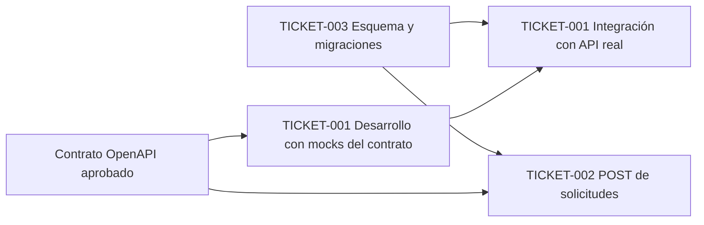

# Tickets de trabajo

> **Prompt de origen:** §6, Prompt 1 — Generación de tickets técnicos bajo metodología SDD y TDD, en [`prompts.md`](../../../prompts.md).
> **Fuente de decisiones aprobadas:** [`README.md`](../../../README.md) §6.
> **Estado:** exactamente tres tickets **aprobados y no implementados**. Prioridad, estimación y sprint: **pendientes** (decisión C6). Ni el harness ni OpenSpec están configurados.

**Alcance de estos tickets.** Son **tickets representativos de la primera entrega académica**: uno de frontend, uno de backend y uno de base de datos. **No constituyen el backlog completo del MVP** ni cubren todas las funcionalidades F01–F07. El trabajo que necesitará tickets posteriores se identifica en el §6, sin generarlos.

## 1. Índice

| Ticket | Tipo | Historia | Funcionalidad | API | Archivo |
|---|---|---|---|---|---|
| TICKET-001 — Implementación del catálogo turístico | Frontend | HU-001 | F01 | `GET /api/v1/attractions` (consumo) | [`TICKET-001.md`](TICKET-001.md) |
| TICKET-002 — Implementación de solicitudes de reserva | Backend | HU-002 | F04 | `POST /api/v1/booking-requests` | [`TICKET-002.md`](TICKET-002.md) |
| TICKET-003 — Implementación del modelo de datos PostgreSQL | Base de datos | Todas | F01–F07 | — | [`TICKET-003.md`](TICKET-003.md) |

HU-003 no tiene un ticket específico entre los tres aprobados (OBS-02 en [`validation-report.md`](../../user-stories/validation-report.md#5-observaciones-pendientes-de-aprobación)).

## 2. Trazabilidad historia → spec → ticket → pruebas

Los identificadores de spec son **documentales y provisionales**, no specs OpenSpec creadas (C7).

| Historia | Requisitos y escenarios | Ticket | Pruebas previstas |
|---|---|---|---|
| HU-001 | HU-001-R01–R07; HU-001-S01–S05 | TICKET-001 | Vitest/RTL (estados y tarjetas), Playwright (exploración y filtro) |
| HU-001 | HU-001-R02, R04 (datos) | TICKET-003 | Integración: activos y relaciones N:M |
| HU-002 | HU-002-R01–R10; HU-002-S01–S06 | TICKET-002 | `httptest`, unitarias del Service, integración con PostgreSQL |
| HU-002 | HU-002-R05, R08 (restricciones) | TICKET-003 | Integración: `CHECK` de exclusividad, fechas y `PENDING` por defecto |
| HU-003 | HU-003-R07–R09 (restricciones de estado) | TICKET-003 | Integración: valores de `status` permitidos |

## 3. Secuencia de implementación y validación (propuesta)

**Estado: propuesta, no aprobada.** La planificación por sprints está pendiente.

| Orden | Trabajo | Motivo |
|---|---|---|
| 1 | TICKET-003 | TICKET-002 depende de las tablas y restricciones; TICKET-001 necesita datos para la integración final |
| 2 | TICKET-002 | Depende de TICKET-003 y del contrato |
| En paralelo | TICKET-001 con mocks del contrato | TICKET-001 se prueba con respuestas simuladas del contrato ([T1-03](TICKET-001.md#4-tareas-verificables)) |
| 3 | TICKET-001, integración final | Requiere un backend disponible. El README no incluye ningún ticket para `GET /api/v1/attractions` en el backend (ver §5) |

## 4. Ciclo común por ticket

| Fase | Responsable | Evidencia exigida | Guardrails ([catálogo](../../ai/sdd-harness.md#7-catálogo-de-guardrails)) |
|---|---|---|---|
| 1. Spec aprobada | Agente de especificaciones + humano (HAP-01) | Requisitos y escenarios citados | GR-01 |
| 2. Pruebas (RED) | Agente de testing | Salida real del fallo esperado | GR-02 |
| 3. Implementación (GREEN) | Agente implementador | Suite en verde, sin cambios en las pruebas | GR-03, GR-06 |
| 4. Refactor | Agente implementador | Suite en verde | GR-03, GR-08 |
| 5. Verificación | CI (cuando exista) | Resultados reales | GR-04, GR-05, GR-07, GR-09, GR-10 |
| 6. Revisión | Revisor adversarial + humano | Hallazgos y decisión | GR-11, GR-12 |

**Definición de terminado común:**
- Criterios de aceptación cubiertos por pruebas trazables.
- Evidencia RED → GREEN → REFACTOR.
- Guardrails aplicables superados o declarados como no aplicados, con su motivo.
- Sin cambios fuera del alcance.
- Aprobación humana.

## 5. Brechas registradas

| Brecha | Consecuencia | Referencia |
|---|---|---|
| No hay ticket de backend para `GET /api/v1/attractions` | TICKET-001 no puede integrarse con una API real hasta que exista ese trabajo | Nueva observación; no se crea ningún ticket |
| No hay ticket para HU-003 | El `PATCH` administrativo queda sin planificar | OBS-02 |
| Prioridad, estimación y sprint | No se asignan valores | C6 |

## 6. Trabajo que requerirá tickets posteriores

Inventario para la planificación futura. **No se generan tickets.** Antes de crearlos deben aprobarse los contratos o las decisiones indicados.

| Funcionalidad u operación | Capa | Prerrequisito |
|---|---|---|
| `GET /api/v1/attractions` (HU-001) | Backend | Contrato existente; A16 |
| `PATCH /api/v1/booking-requests/{id}/status` (HU-003) | Backend | Contrato existente; A5 |
| Consulta y filtrado administrativo de solicitudes (HU-003) | Backend y frontend | Contrato pendiente (A1); A5 |
| Formulario de solicitud y confirmación de recepción (HU-002) | Frontend | Contrato existente; A11, A12, A18 |
| Área administrativa: bandeja, detalle y resolución (HU-003) | Frontend | A1, A5 |
| Autenticación de `TOURIST` y `ADMIN` | Frontend, backend y datos | ADR-P01 (A5) |
| F02 — Catálogo de alojamientos | Frontend y backend | Historia y contrato no definidos (A10); A2 |
| F03 — Tours y experiencias | Frontend y backend | Historia y contrato no definidos (A10); A2 |
| F06 — Mapa turístico | Frontend y backend | Historia y contrato no definidos (A10) |
| F07 — Planificador de recorridos | Frontend y backend | Historia y contrato no definidos (A10); A5, A13, A19 |
| Infraestructura: imágenes Docker, Coolify, backups externos | Operación | ADR-D03; A8, A14, A15 |
| Harness, OpenSpec y CI | Proceso | Adopción pendiente ([`sdd-harness.md`](../../ai/sdd-harness.md#10-decisiones-pendientes)) |

La carga y el mantenimiento del contenido del catálogo (PQ-06 en [`prd.md`](../../product/prd.md#104-preguntas-abiertas)) no tienen ninguna funcionalidad aprobada. No se incluye en el inventario hasta que el producto lo decida.
