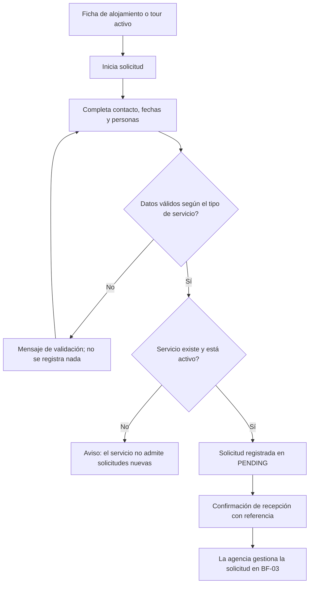
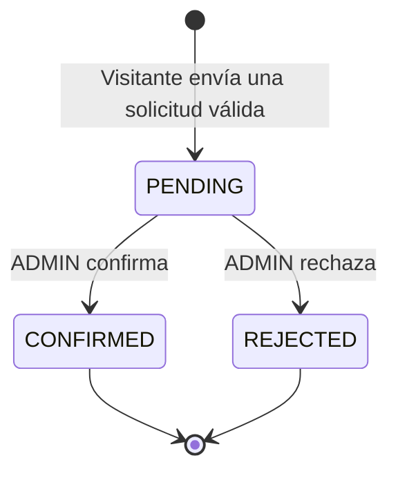
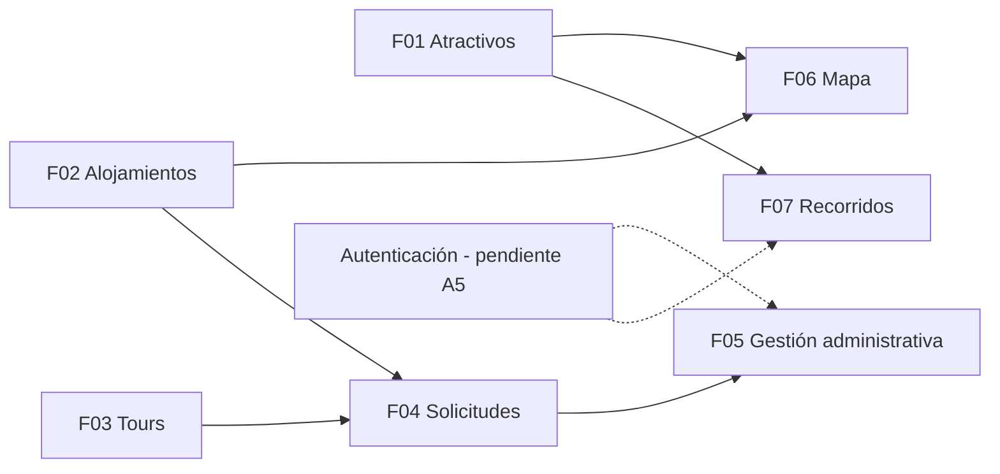

# Flujos de negocio y alcance del MVP

> **Prompt de origen:** §1, Prompt 2 — Delimitación del MVP y definición de flujos de negocio, en [`prompts.md`](../../prompts.md).
> **Fuente de decisiones aprobadas:** [`README.md`](../../README.md) §1.2, §1.3, §2.5 (matriz de permisos) y §3.2 (reglas de `booking_requests` y `travel_plans`).
> **Estado del documento:** análisis funcional pendiente de revisión humana. No define tablas, endpoints ni componentes técnicos.

Este documento es la referencia principal de **actores, reglas funcionales y estados de la solicitud**. Los demás documentos lo enlazan en lugar de repetir las reglas.

## 1. Límites del producto

| Límite | Estado |
|---|---|
| Las reservas se gestionan como **solicitudes**, no como compras. | Confirmado |
| No hay cobros ni pasarelas de pago. | Confirmado |
| Enviar una solicitud no garantiza disponibilidad. | Confirmado |
| El catálogo se explora sin autenticación. | Confirmado |
| Existe un área administrativa para gestionar solicitudes. | Confirmado |
| No hay integraciones obligatorias con operadores ni proveedores externos. | Confirmado |
| No se incorporan funcionalidades fuera de F01–F07 sin aprobación. | Confirmado |

## 2. Actores y responsabilidades

| Actor | Responsabilidades en la plataforma | No le corresponde | Estado |
|---|---|---|---|
| Visitante anónimo | Explorar atractivos, alojamientos, tours y mapa; enviar solicitudes con datos de contacto veraces | Guardar recorridos; consultar solicitudes ajenas | Confirmado |
| Turista registrado (`TOURIST`) | Lo mismo que el visitante, más crear, editar, guardar y recuperar **sus propios** recorridos | Gestionar solicitudes; acceder a recorridos ajenos | Confirmado |
| Personal de la agencia (`ADMIN`) | Consultar, filtrar y resolver solicitudes; proteger los datos de contacto que consulta | Crear recorridos como función administrativa (no definido, A7) | Confirmado; A7 pendiente |
| Prestador turístico | Ninguna acción en la plataforma; beneficiario indirecto | Autogestionar su oferta | Confirmado |
| Responsable de contenido | Mantener actualizada la información del catálogo | — | Responsabilidad de la agencia; mecanismo pendiente (PQ-06 en [`prd.md`](prd.md#104-preguntas-abiertas)) |

## 3. Flujos de negocio principales

### BF-01 — Descubrimiento y exploración

**Actor:** visitante (también `TOURIST` y `ADMIN`). **Funcionalidades:** F01, F02, F03, F06.

1. El visitante accede al inicio o a un catálogo (atractivos, alojamientos o tours).
2. Busca por nombre o aplica filtros (categoría, tipo, servicios, duración, según el catálogo).
3. Consulta resultados paginados de elementos **activos**.
4. Abre una ficha con fotografías, descripción, ubicación e información relevante.
5. Opcionalmente consulta su ubicación en el mapa (F06) o vuelve desde el mapa a la ficha.
6. Si la ficha es de un alojamiento o tour, puede iniciar BF-02.

**Resultado:** el visitante identifica un lugar o servicio de interés sin haberse autenticado.

### BF-02 — Solicitud de reserva

**Actor:** visitante, sin necesidad de cuenta. **Funcionalidades:** F04, apoyada en F02 y F03.

**Resultado:** solicitud registrada en `PENDING` con un identificador de referencia. El visitante entiende que **no** es una reserva confirmada.

### BF-03 — Gestión administrativa de solicitudes

**Actor:** `ADMIN` autenticado. **Funcionalidad:** F05.

1. El administrador inicia sesión (mecanismo pendiente, A5).
2. Consulta las solicitudes y filtra por estado, tipo de servicio y fechas (el contrato de esta consulta está pendiente, A1).
3. Abre el detalle: servicio solicitado, fechas, personas, datos de contacto y observaciones.
4. La comunicación posterior con el visitante no está definida (A18); no se asume ningún mecanismo de notificación.
5. Confirma o rechaza la solicitud.
6. El sistema aplica la transición solo si la solicitud sigue en `PENDING`.

**Resultado:** la solicitud queda en un estado final (`CONFIRMED` o `REJECTED`) y ya no admite cambios.

#### Ciclo de vida de una solicitud

No existe ninguna otra transición. Las solicitudes en `CONFIRMED` y `REJECTED` son finales.

### BF-04 — Planificación de un recorrido personalizado

**Actor:** `TOURIST`. **Funcionalidades:** F07, apoyada en F01 y F06.

1. El turista inicia sesión (mecanismo pendiente, A5).
2. Crea un recorrido con un nombre.
3. Agrega atractivos desde el catálogo o el mapa, asignándolos a un día y una posición.
4. Reordena, quita o repite atractivos (un mismo atractivo puede aparecer en posiciones o días distintos).
5. Consulta el resumen del recorrido y lo guarda.
6. En otro acceso, recupera sus recorridos guardados.

**Resultado:** un recorrido persistente y recuperable que pertenece solo a ese turista.

**Implicaciones de guardar la planificación:**

| Implicación | Consecuencia | Estado |
|---|---|---|
| El recorrido pertenece a una cuenta | Hace falta autenticación y control de propiedad | Confirmado; mecanismo pendiente (A5) |
| Un atractivo puede desactivarse después de guardarse | El recorrido lo conserva, aunque ya no aparezca en el catálogo público | Confirmado (README §3.2) |
| La posición (día, orden) es única dentro del recorrido | Reordenar exige intercambiar posiciones sin dejar duplicados intermedios | Confirmado; estrategia técnica pendiente (A19) |
| Uso del planificador sin cuenta | El README indica que, sin autenticación, solo se consulta información pública; no queda claro si se permite un borrador no guardado | Pendiente (A13) |

## 4. Reglas y validaciones por flujo

Los códigos `RN-xx` son identificadores documentales de esta ejecución.

### 4.1. BF-01 — Descubrimiento

| Código | Regla | Estado | Fuente |
|---|---|---|---|
| RN-01 | Solo se muestran elementos activos (`is_active`) en los catálogos públicos. | Confirmada | README §5 (HU-001), §3.2 |
| RN-02 | La consulta no requiere autenticación. | Confirmada | README §1.2 |
| RN-03 | Los resultados se presentan paginados. | Confirmada | README §5 (HU-001) |
| RN-04 | La búsqueda por nombre y el filtro por categoría pueden combinarse. | Confirmada; el comportamiento exacto de la combinación está pendiente (A16) | [TICKET-001 §5](../delivery/tickets/TICKET-001.md#5-criterios-de-aceptación-readme-6) |
| RN-05 | Sin coincidencias se informa sin presentar un error técnico. | Confirmada | README §5 (HU-001) |
| RN-06 | Filtrar F02/F03 por "ubicación" | Pendiente: el modelo no tiene un campo de ubicación estructurado (A2) | README §1.2 |
| RN-07 | Significado de "intereses" como filtro de F01 | Pendiente: ¿sinónimo de categoría? (A3) | README §1.2 |

### 4.2. BF-02 — Solicitud de reserva

| Código | Regla | Estado | Fuente |
|---|---|---|---|
| RN-10 | Una solicitud referencia exactamente un alojamiento **o** un tour. | Confirmada | README §3.2 |
| RN-11 | Nombre y correo de contacto son obligatorios; el correo se valida en formato y no es único. | Confirmada | README §5 (HU-002); [`data-model.md` §3.13](../data/data-model.md#313-booking_requests) |
| RN-12 | Teléfono y observaciones son opcionales. | Confirmada | README §5 (HU-002) |
| RN-13 | La cantidad de personas es mayor que cero. | Confirmada | README §6 (TICKET-002) |
| RN-14 | Alojamiento: fecha de entrada y de salida obligatorias; la salida es posterior a la entrada. | Confirmada | README §3.2 |
| RN-15 | Tour: solo fecha prevista de realización; sin fecha de salida. | Confirmada | README §3.2 |
| RN-16 | El servicio debe existir y estar activo. | Confirmada | README §6 (TICKET-002) |
| RN-17 | Toda solicitud nueva queda en `PENDING`. | Confirmada | README §1.2, §4 |
| RN-18 | La recepción no implica disponibilidad ni genera pago. | Confirmada | README §5 (HU-002) |
| RN-19 | Se entrega un número de referencia. | Confirmada; queda pendiente si es el UUID o un código legible (A11) | README §1.2 |
| RN-20 | Fechas en el pasado, antelación mínima o máxima y número máximo de personas | Pendiente: no definidas (A12) | — |
| RN-21 | Detección de solicitudes duplicadas del mismo visitante | Pendiente: no definida (A12) | — |

### 4.3. BF-03 — Gestión administrativa

| Código | Regla | Estado | Fuente |
|---|---|---|---|
| RN-30 | Solo `ADMIN` consulta y resuelve solicitudes. | Confirmada | README §2.5 |
| RN-31 | Transiciones válidas únicamente `PENDING → CONFIRMED` y `PENDING → REJECTED`. | Confirmada | README §3.2 |
| RN-32 | `CONFIRMED` y `REJECTED` son finales. | Confirmada | README §3.2 |
| RN-33 | Ante resoluciones simultáneas, solo se aplica la primera válida; las demás se informan como conflicto. | Confirmada | README §5 (HU-003) |
| RN-34 | Los errores no modifican indebidamente los datos. | Confirmada | README §5 (HU-003) |
| RN-35 | Se audita el acceso administrativo y las operaciones sobre solicitudes. | Confirmada como requisito; el mecanismo y la persistencia están pendientes (A4) | README §2.5 |
| RN-36 | Motivo de rechazo y comunicación del resultado al visitante | Pendiente: no definidos (A18) | — |

### 4.4. BF-04 — Recorridos

| Código | Regla | Estado | Fuente |
|---|---|---|---|
| RN-40 | Solo `TOURIST` crea y administra recorridos, únicamente los propios. | Confirmada | README §3.2, §2.5 |
| RN-41 | Cada elemento tiene día y posición positivos; la posición es única por día dentro del recorrido. | Confirmada | [`data-model.md` §5](../data/data-model.md#5-restricciones-de-integridad) (DC-16, DC-17) |
| RN-42 | Un atractivo puede repetirse, incluso el mismo día, en posiciones diferentes. | Confirmada | README §1.2, §3.2 |
| RN-43 | Los atractivos desactivados se conservan en recorridos ya guardados. | Confirmada | README §3.2 |
| RN-44 | No hay generación automática con IA ni optimización de rutas. | Confirmada | README §1.2 |
| RN-45 | Qué puede hacer `ADMIN` sobre recorridos | Pendiente (A7) | README §2.5 |
| RN-46 | Número máximo de días o de elementos por recorrido | Pendiente: no definido | — |

## 5. Casos alternativos y excepciones

| Flujo | Situación | Comportamiento esperado | Estado |
|---|---|---|---|
| BF-01 | Sin coincidencias | Estado vacío informativo | Confirmado |
| BF-01 | Fallo de comunicación | Aviso recuperable, con opción de reintentar | Confirmado (README §1.3) |
| BF-02 | Datos obligatorios ausentes o inválidos | Mensaje por campo; no se registra la solicitud | Confirmado |
| BF-02 | Salida anterior o igual a la entrada | Error de validación; no se registra | Confirmado |
| BF-02 | Tour con fecha de salida informada | Error de validación | Confirmado (TICKET-002) |
| BF-02 | Alojamiento y tour a la vez, o ninguno | Error de validación | Confirmado |
| BF-02 | Servicio inexistente o desactivado | Aviso de que no admite solicitudes nuevas | Confirmado |
| BF-02 | Servicio desactivado mientras el visitante completa el formulario | Mismo tratamiento que el caso anterior al enviar | Inferido de RN-16 |
| BF-03 | Usuario sin rol `ADMIN` | Acceso denegado | Confirmado |
| BF-03 | Solicitud ya resuelta | Conflicto; no se modifica | Confirmado |
| BF-03 | Dos administradores resuelven a la vez | Se aplica la primera; la segunda recibe conflicto | Confirmado |
| BF-03 | Solicitud inexistente | Recurso no encontrado | Confirmado |
| BF-04 | Usuario no autenticado intenta guardar | Se le pide autenticarse | Confirmado; experiencia exacta pendiente (A13) |
| BF-04 | Atractivo del recorrido desactivado | Permanece en el recorrido; su presentación está pendiente de diseño UX | Regla confirmada; presentación pendiente |

## 6. Dependencias entre funcionalidades

| Funcionalidad | Depende de | Estado |
|---|---|---|
| F04 | F02 o F03 con servicios activos | Confirmado |
| F05 | F04 y autenticación/autorización `ADMIN` | Confirmado; A5 pendiente |
| F06 | Coordenadas de los catálogos (F01, F02) | Confirmado; los tours no tienen coordenadas en el modelo |
| F07 | F01 y cuenta `TOURIST` | Confirmado; A5 pendiente |

## 7. Capacidades que requieren decisiones funcionales antes del desarrollo

| Funcionalidad | Decisión requerida | Referencia |
|---|---|---|
| F01 | Significado de "intereses" | A3 |
| F02, F03 | Filtro por ubicación sin campo estructurado | A2 |
| F04 | Formato del número de referencia; reglas de fechas pasadas, antelación y máximo de personas | A11, A12 |
| F05 | Contrato de consulta y filtrado; autenticación; auditoría; comunicación del resultado | A1, A5, A4, A18 |
| F06 | Ninguna funcional adicional detectada; depende de datos con coordenadas | — |
| F07 | Uso sin cuenta; papel del `ADMIN`; límites del recorrido | A13, A7, RN-46 |

## 8. Preguntas pendientes de negocio

1. ¿El número de referencia que recibe el visitante es el identificador interno o un código legible? (A11)
2. ¿Se aceptan solicitudes con fechas pasadas? ¿Existe antelación mínima o un máximo de personas? (A12)
3. ¿Cómo y por qué canal se informa al visitante que su solicitud fue confirmada o rechazada? ¿Se registra un motivo de rechazo? (A18)
4. ¿"Intereses" en F01 equivale a categorías? (A3)
5. ¿Cómo se filtrarán alojamientos y tours por ubicación? (A2)
6. ¿Puede un visitante sin cuenta armar un recorrido temporal antes de registrarse? (A13)
7. ¿El `ADMIN` tiene alguna función sobre los recorridos? (A7)

Todas están registradas en el [registro central de pendientes](../README.md#registro-de-pendientes).
