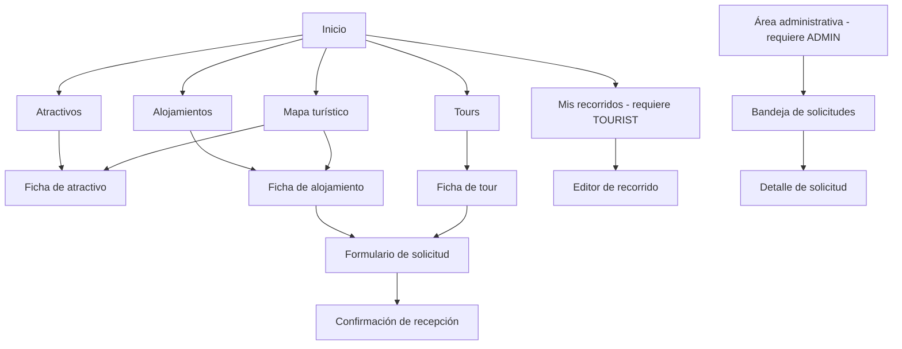

# Diseño de experiencia de usuario

> **Prompt de origen:** §1, Prompt 3 — Diseño de experiencia de usuario (UX), en [`prompts.md`](../../prompts.md).
> **Fuente de decisiones aprobadas:** [`README.md`](../../README.md) §1.3; reglas de [`business-flows.md`](business-flows.md).
> **Estado del documento:** propuesta funcional de UX pendiente de validación. No existen wireframes, prototipos ni interfaz implementada. No se ha seleccionado ninguna biblioteca de componentes ni herramienta de diseño.

## 1. Necesidades de usabilidad

| Perfil | Necesidad de usabilidad | Implicación de diseño |
|---|---|---|
| Visitante (móvil) | Descubrir rápido, con contenido visual y pocos pasos | Inicio con accesos directos a los tres catálogos; tarjetas con imagen principal |
| Visitante | Entender dónde está cada lugar | Ubicación visible en la ficha y acceso al mapa |
| Visitante | Enviar una solicitud sin crear cuenta | Formulario corto, adaptado al tipo de servicio |
| Visitante | No confundir solicitud con reserva | Lenguaje de "solicitud recibida", nunca "reserva confirmada" |
| Visitante internacional | Comprender el contenido | Idiomas no definidos (PQ-05 en [`prd.md`](prd.md#104-preguntas-abiertas)) |
| `TOURIST` | Organizar lugares por días y recuperarlos | Editor de recorrido con días y orden; listado de recorridos propios |
| `ADMIN` | Encontrar y resolver pendientes con rapidez y sin errores | Bandeja filtrada por estado; acciones de confirmar y rechazar con confirmación previa |
| Todos | Accesibilidad y uso con teclado | Ver §9 |

## 2. Organización de la información

La navegación principal propuesta tiene cinco entradas: Atractivos, Alojamientos, Tours, Mapa y Mis recorridos. El área administrativa no forma parte de la navegación pública. La definición final del menú está pendiente de validación (README §1.3).

## 3. Vistas principales sugeridas

| Código | Vista | Funcionalidad | Acceso | Contenido principal |
|---|---|---|---|---|
| V-01 | Inicio | F01–F03 | Público | Imágenes destacadas, atractivos recomendados, accesos a catálogos |
| V-02 | Catálogo de atractivos | F01 | Público | Búsqueda, filtro por categoría, resultados paginados |
| V-03 | Ficha de atractivo | F01, F06 | Público | Galería, descripción, ubicación, acceso al mapa, opción de agregar a un recorrido |
| V-04 | Catálogo de alojamientos | F02 | Público | Búsqueda y filtros por tipo y servicios (ubicación pendiente, A2) |
| V-05 | Ficha de alojamiento | F02, F04 | Público | Galería, servicios, contacto, ubicación, acción "Solicitar reserva" |
| V-06 | Catálogo de tours | F03 | Público | Búsqueda y filtros por tipo y duración (ubicación pendiente, A2) |
| V-07 | Ficha de tour | F03, F04 | Público | Itinerario descriptivo, duración, punto de encuentro, acción "Solicitar reserva" |
| V-08 | Mapa turístico | F06 | Público | Marcadores filtrables por categoría y tarjeta contextual |
| V-09 | Formulario de solicitud | F04 | Público | Campos según el tipo de servicio, validación y envío |
| V-10 | Confirmación de recepción | F04 | Público | Referencia, estado `PENDING` y aclaración de no disponibilidad |
| V-11 | Mis recorridos | F07 | `TOURIST` | Listado de recorridos propios |
| V-12 | Editor de recorrido | F07 | `TOURIST` | Días, orden, agregar, quitar, reordenar y resumen |
| V-13 | Acceso (inicio de sesión) | F05, F07 | Público | Depende del mecanismo de autenticación (A5) |
| V-14 | Bandeja de solicitudes | F05 | `ADMIN` | Filtros por estado, tipo de servicio y fechas (contrato pendiente, A1) |
| V-15 | Detalle de solicitud | F05 | `ADMIN` | Datos de contacto, observaciones y acciones de confirmar o rechazar |

## 4. Recorridos de navegación

| Recorrido | Pasos | Resultado |
|---|---|---|
| UJ-01 Explorar catálogo | V-01 → V-02 → búsqueda o filtro → V-03 | Ficha consultada |
| UJ-02 Desde el mapa | V-08 → marcador → tarjeta contextual → V-03 o V-05 | Ficha consultada |
| UJ-03 Solicitar alojamiento | V-04 → V-05 → V-09 → V-10 | Solicitud recibida en `PENDING` |
| UJ-04 Solicitar tour | V-06 → V-07 → V-09 → V-10 | Solicitud recibida en `PENDING` |
| UJ-05 Crear recorrido | V-03 → "Agregar a recorrido" → V-13 si no hay sesión → V-12 → guardar | Recorrido guardado |
| UJ-06 Resolver solicitud | V-13 → V-14 (filtro `PENDING`) → V-15 → confirmar o rechazar → V-14 actualizada | Solicitud resuelta |

## 5. Información geográfica y mapa

**Contenido aprobado (README §1.2, F06):** mapa de Barquisimeto y alrededores; marcadores de monumentos, sitios históricos y culturales, espacios deportivos, parques, hoteles y posadas; filtros por categoría; información contextual (nombre, fotografía y descripción breve); acceso a la ficha; zoom y desplazamiento.

**Alternativas de presentación:**

| Alternativa | Ventajas | Limitaciones |
|---|---|---|
| A — Mapa como vista independiente (V-08) | Más simple de construir y probar; los catálogos no dependen del mapa | El usuario cambia de contexto para ubicar resultados |
| B — Alternar lista y mapa dentro de cada catálogo | Ubica los resultados filtrados sin salir del catálogo | Duplica la lógica de filtros; en móvil compite por el espacio |
| C — Mapa pequeño solo en la ficha, más la vista independiente | Contexto puntual en cada ficha | Más instancias de mapa que mantener |

**Recomendación a validar:** A, más una ubicación textual en la ficha. Cubre F06 con la menor complejidad.

**Consideraciones:**
- Los tours no tienen coordenadas en el modelo (solo `meeting_point` como texto), así que no aparecen como marcadores. Coincide con la lista de marcadores aprobada.
- Toda información del mapa debe tener un equivalente textual accesible (ver §9).
- La biblioteca o el servicio de mapas no está seleccionado; cualquier proveedor externo requiere aprobación.

## 6. Experiencia de la solicitud de reserva

### 6.1. Campos según el tipo de servicio

| Campo | Alojamiento | Tour | Validación en la interfaz (ayuda al usuario) |
|---|---|---|---|
| Nombre de contacto | Obligatorio | Obligatorio | No vacío |
| Correo electrónico | Obligatorio | Obligatorio | Formato de correo |
| Teléfono | Opcional | Opcional | — |
| Fecha de entrada / fecha prevista | Obligatoria | Obligatoria | Fecha válida; pasadas pendiente (A12) |
| Fecha de salida | Obligatoria, posterior a la entrada | No se muestra | Salida posterior a la entrada |
| Cantidad de personas | Obligatoria, mayor que cero | Obligatoria, mayor que cero | Entero mayor que cero |
| Observaciones | Opcional | Opcional | — |

El servicio (alojamiento o tour) viene de la ficha desde la que se inicia la solicitud, por lo que el visitante no elige el tipo manualmente. La validación en la interfaz **no sustituye** a la del backend ([`components.md`](../architecture/components.md#5-reglas-que-se-ejecutan-exclusivamente-en-el-backend)).

### 6.2. Mensajes

| Situación | Mensaje propuesto (orientativo) | Comportamiento |
|---|---|---|
| Envío correcto | "Recibimos tu solicitud. Referencia: …. La agencia la revisará. Esta solicitud no es una reserva confirmada ni implica un pago." No se promete un canal de respuesta: el mecanismo de comunicación posterior está pendiente (A18) | Muestra V-10 |
| Error de validación | Mensaje junto a cada campo, más un resumen al inicio del formulario | Conserva los datos introducidos |
| Servicio no disponible | "Este servicio no admite solicitudes nuevas en este momento." | Ofrece volver al catálogo |
| Fallo de comunicación | "No pudimos enviar tu solicitud. Revisa tu conexión e inténtalo de nuevo." | Conserva los datos; permite reintentar |
| Envío en curso | Indicador de carga y botón deshabilitado | Evita envíos duplicados desde la interfaz |

Los textos definitivos, el formato de la referencia (A11), el tratamiento de las fechas pasadas (A12) y el mecanismo de comunicación posterior con el visitante (A18) están pendientes.

## 7. Planificador de recorridos

**Relación con la cuenta:** guardar y recuperar requiere `TOURIST`. Si se puede componer un borrador sin sesión está pendiente (A13).

**Interacción propuesta:**
- Agregar atractivos desde la ficha (V-03) o desde el mapa, eligiendo día y posición.
- Organización por días: cada día muestra sus atractivos en orden.
- Reordenar, quitar y repetir atractivos.
- Resumen del recorrido con nombre, descripción e información relevante de cada lugar.
- Los atractivos desactivados después de guardarse se mantienen y se señalan como no disponibles en el catálogo. El tratamiento visual exacto está pendiente.

**Alternativas para reordenar:**

| Alternativa | Ventajas | Limitaciones |
|---|---|---|
| Arrastrar y soltar | Intuitivo en escritorio | Difícil con teclado y lectores de pantalla; impreciso en móvil |
| Botones subir/bajar y selector de día | Accesible y predecible con teclado | Más pasos para movimientos largos |
| Ambos, con botones como alternativa obligatoria | Combina las dos ventajas | Más estados que diseñar y probar |

**Recomendación a validar:** botones como mecanismo base. Arrastrar y soltar solo como complemento, nunca como única vía (accesibilidad, §9).

## 8. Componentes visuales reutilizables

| Componente | Uso | Vistas |
|---|---|---|
| Tarjeta de elemento (atractivo, alojamiento, tour) | Resultados de catálogo, recomendados, mapa | V-01, V-02, V-04, V-06, V-08 |
| Barra de búsqueda | Búsqueda por nombre | V-02, V-04, V-06 |
| Panel de filtros | Categoría, tipo, servicios, duración | V-02, V-04, V-06, V-08, V-14 |
| Paginación | Navegación de resultados | V-02, V-04, V-06, V-14 |
| Galería de imágenes | Fotografías respetando `display_order` e imagen principal | V-03, V-05, V-07 |
| Bloque de ubicación | Dirección o ubicación textual y acceso al mapa | V-03, V-05, V-07 |
| Campo de formulario con validación | Etiqueta, ayuda y mensaje de error asociado | V-09, V-13 |
| Indicador de estado de solicitud | `PENDING`, `CONFIRMED`, `REJECTED` con texto, no solo color | V-10, V-14, V-15 |
| Estados de interfaz | Carga, vacío, error, éxito | Todas |
| Diálogo de confirmación | Confirmar o rechazar una solicitud | V-15 |

Son propuestas de UX; no hay biblioteca de componentes seleccionada.

## 9. Comportamiento responsive

| Contexto | Criterio propuesto |
|---|---|
| Teléfono | Una columna; filtros en un panel desplegable; acciones principales visibles; formulario en una columna |
| Tablet | Dos columnas de tarjetas; filtros desplegables o laterales según el espacio |
| Computadora | Cuadrícula de tarjetas con filtros laterales; bandeja administrativa en formato de tabla |
| Todos | Imágenes adaptadas al ancho; objetivos táctiles de tamaño suficiente; sin desplazamiento horizontal |

Los puntos de quiebre concretos se definirán en el diseño visual; no se fijan valores aquí.

## 10. Estados de interacción

| Estado | Dónde aplica | Comportamiento |
|---|---|---|
| `loading` | Catálogos, fichas, mapa, envío de formularios, bandeja | Indicador visible y anunciado a lectores de pantalla |
| `empty` | Catálogos y bandeja sin resultados | Mensaje informativo y sugerencia de limpiar filtros |
| `error` | Fallo de comunicación con la API | Mensaje comprensible sin detalles técnicos; opción de reintentar |
| Validación | Formularios | Error por campo, más un resumen enfocable |
| Éxito | Envío de solicitud, guardado de recorrido, resolución | Confirmación explícita del resultado |
| Conflicto | Resolución de una solicitud ya resuelta | "Esta solicitud ya fue resuelta por otra persona", y se actualiza el estado mostrado |
| Acceso denegado | Rutas `ADMIN` o `TOURIST` sin permiso | Mensaje claro y redirección al acceso cuando corresponda |

## 11. Accesibilidad

Referencia: criterios WCAG aplicables, **sin declarar conformidad ni pruebas realizadas** (README §1.3).

- Etiquetas visibles y asociadas a cada campo; mensajes de error vinculados al campo.
- Navegación completa con teclado, en orden lógico y con foco visible.
- Contraste de texto legible.
- Texto alternativo en las imágenes del catálogo.
- Estados (solicitud, errores, disponibilidad) que no dependan solo del color.
- Alternativa textual a la información del mapa y a cualquier interacción de arrastrar y soltar.
- Anuncio de cambios dinámicos (carga, resultados, errores).

## 12. Aspectos que necesitan validación de producto

| Aspecto | Referencia |
|---|---|
| Menú definitivo y orden de la navegación | README §1.3 |
| Presentación del mapa (alternativas A, B o C) | §5 |
| Interacción del reordenamiento | §7 |
| Uso del planificador sin cuenta | A13 |
| Formato de la referencia de solicitud y textos definitivos | A11 |
| Filtros por ubicación | A2 |
| Detalles de interacción del panel administrativo | PQ-03, A1 |
| Idiomas del contenido | PQ-05 |
| Wireframes, capturas o video | Se incorporarán cuando exista interfaz implementada (README §1.3) |
